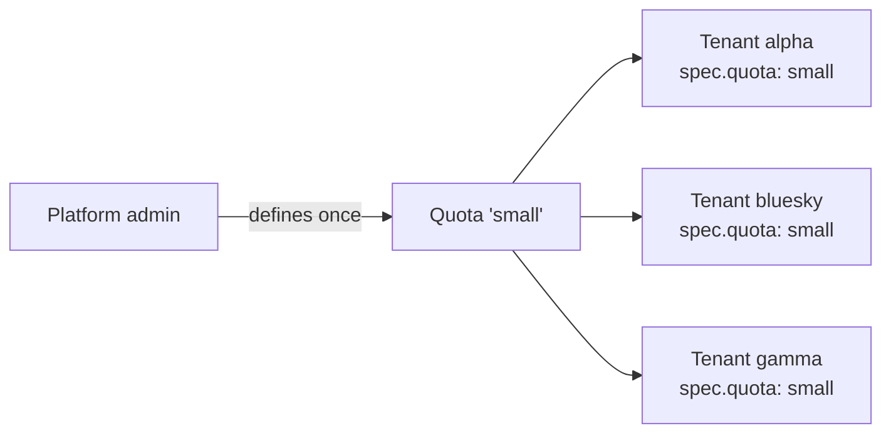
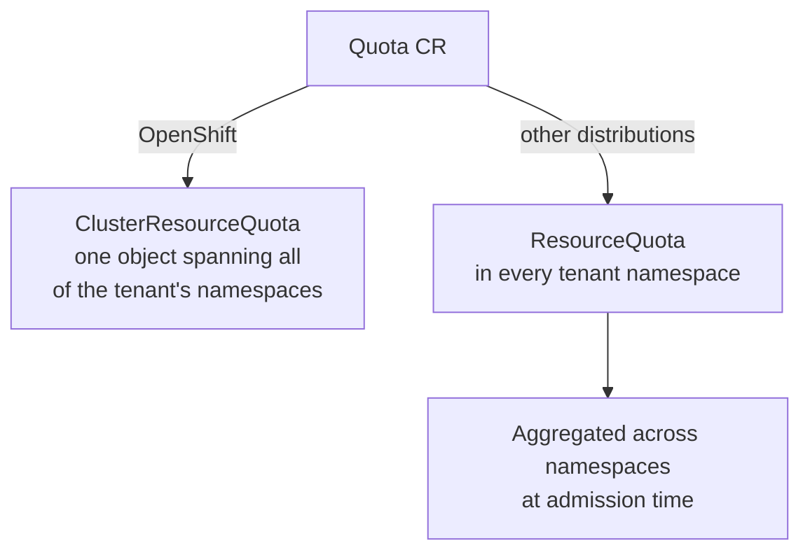

# Quota

A **Quota** is a reusable allocation profile owned by the cluster
administrator. It defines the resource ceilings a tenant may consume
(`resourcequota`) and, optionally, per-object defaults and bounds
(`limitrange`). A [Tenant](tenant.md) references a Quota by name through its
`spec.quota` field.

The value is in the indirection: **one Quota can back many tenants**. The admin
defines `small`, `medium` and `large` once, assigns them, and changes a tier in
a single place for every tenant that uses it. It also keeps duties separate —
admins own the ceilings, tenant owners work freely beneath them.



## How a Quota is enforced

The ceiling is the same everywhere; the underlying object the operator creates
differs by distribution.



* On **OpenShift**, MTO relies on a
  [ClusterResourceQuota](https://docs.redhat.com/en/documentation/openshift_container_platform/4.18/html/schedule_and_quota_apis/clusterresourcequota-quota-openshift-io-v1)
  that spans all of the tenant's namespaces and does the calculation natively.
* On **other Kubernetes distributions**, MTO creates a standard
  [ResourceQuota](https://kubernetes.io/docs/concepts/policy/resource-quotas/)
  in each tenant namespace and aggregates usage at admission time.

!!! warning "Preview on Kubernetes"
    Quota enforcement on non-OpenShift distributions is a preview feature. Under
    webhook load it can admit more than the configured ceiling. Reach out to
    [Stakater Support](https://support.stakater.com/) with any questions.

## The spec at a glance

A Quota is served at `tenantoperator.stakater.com/v1beta1` (note: the
[Tenant](tenant.md) that links it is `v1beta3`). The `spec` has two fields,
each a standard Kubernetes type, so any key those types support can be set:

| Field | Required | What it controls |
|-------|----------|------------------|
| `resourcequota` | ✅ | Aggregate resource ceilings for the tenant — a [ResourceQuotaSpec](https://kubernetes.io/docs/reference/generated/kubernetes-api/v1.30/#resourcequotaspec-v1-core). |
| `limitrange` | | Per-object defaults, minimums and maximums — a [LimitRangeSpec](https://kubernetes.io/docs/reference/generated/kubernetes-api/v1.30/#limitrangespec-v1-core). |

For a manifest you can adapt, see
[Assigning a quota to a tenant](#assigning-a-quota-to-a-tenant) below; the full
generated schema is in the [API reference](../reference/api.md#quota).

## Assigning a quota to a tenant

Bill, a cluster admin, first creates a `Quota` with the ceilings Anna's tenant
will have. `limitrange` is optional — skip it if you don't need per-object
bounds.

```yaml
kubectl create -f - << EOF
apiVersion: tenantoperator.stakater.com/v1beta1
kind: Quota
metadata:
  name: small
spec:
  resourcequota:
    hard:
      requests.cpu: '5'
      requests.memory: '5Gi'
      configmaps: "10"
      secrets: "10"
      services: "10"
      services.loadbalancers: "2"
  limitrange:
    limits:
      - type: "Pod"
        max:
          cpu: "2"
          memory: "1Gi"
        min:
          cpu: "200m"
          memory: "100Mi"
EOF
```

```bash
kubectl get quota small
NAME       STATE    AGE
small      Active   3m
```

Bill then creates Anna's tenant, linking the `small` quota through
`spec.quota`:

```yaml
kubectl create -f - << EOF
apiVersion: tenantoperator.stakater.com/v1beta3
kind: Tenant
metadata:
  name: bluesky
spec:
  quota: small
  accessControl:
    owners:
      users:
        - anna@aurora.org
        - anthony@aurora.org
  namespaces:
    withTenantPrefix:
      - production
    sandboxes:
      enabled: true
EOF
```

Anna can now create resources freely up to the quota's ceilings:

```bash
kubectl -n bluesky-production create deployment nginx --image nginx:latest --replicas 4
```

Once the tenant's usage reaches a ceiling, further resources are rejected:

```bash
kubectl -n bluesky-production run overflow --image=nginx:latest
Error from server (Cannot exceed Namespace quota: please, reach out to the system administrators)
```

## Limiting total storage

To cap the storage a tenant may provision, Bill adds `requests.storage` to
`resourcequota.hard`. This Quota limits the tenant to `50Gi` across all its
namespaces:

```yaml
kubectl create -f - << EOF
apiVersion: tenantoperator.stakater.com/v1beta1
kind: Quota
metadata:
  name: medium
spec:
  resourcequota:
    hard:
      requests.cpu: '5'
      requests.memory: '10Gi'
      requests.storage: '50Gi'
EOF
```

Link it to the tenant the same way — set `spec.quota: medium` on the Tenant.
The combined storage used by all of the tenant's namespaces will then not
exceed `50Gi`.

## Limiting storage per StorageClass

To cap how much a tenant may provision **from a specific StorageClass**, Bill
uses the `<storage-class-name>.storageclass.storage.k8s.io/requests.storage`
key. This Quota limits provisioning from the `stakater` StorageClass to `20Gi`:

```yaml
kubectl create -f - << EOF
apiVersion: tenantoperator.stakater.com/v1beta1
kind: Quota
metadata:
  name: sc-limited
spec:
  resourcequota:
    hard:
      requests.cpu: '2'
      requests.memory: '4Gi'
      stakater.storageclass.storage.k8s.io/requests.storage: '20Gi'
EOF
```

Link it with `spec.quota: sc-limited`. The combined storage provisioned from
the `stakater` StorageClass across the tenant's namespaces will then not exceed
`20Gi`.

!!! note
    This limit applies **only** to the named StorageClass. A PVC created with a
    different StorageClass is not restricted by this key.

!!! tip
    For the full set of quota keys, see the Kubernetes
    [Resource Quotas](https://kubernetes.io/docs/concepts/policy/resource-quotas/)
    documentation.

## Related guides

* [Create a Tenant](../guides/create-tenant.md)
* [Restricting Storage Classes per Tenant](../guides/storage-classes.md)
