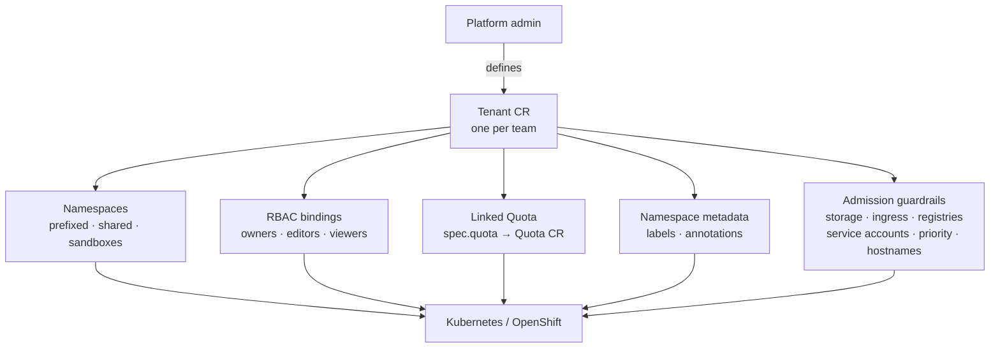

# Tenant

A **Tenant** is the single declarative definition of one team's slice of the
cluster. In one object you describe *who* the team is, *where* they run, and
*what they may consume* — and the operator turns that into the namespaces, RBAC,
resource quota, metadata and admission guardrails that make it real, keeping
them in sync as the Tenant changes.

Because everything derives from one object, the pieces cannot drift apart:
membership, namespaces, allocation and standards always agree with each other.

## What the operator creates from a Tenant



## A minimal Tenant

The smallest valid Tenant needs only a `quota`, which caps what the team can
consume:

```yaml
apiVersion: tenantoperator.stakater.com/v1beta3
kind: Tenant
metadata:
  name: alpha
spec:
  quota: small
```

!!! note
    A minimal Tenant does not set `storageClasses`, `ingressClasses` or
    `podPriorityClasses`. Those guardrails are **disabled by default**, which
    leaves RBAC for those cluster-scoped resources to the platform
    administrator. See [Resource guardrails](#resource-guardrails) to enable
    them.

## The spec at a glance

| Field | Required | What it controls |
|-------|----------|------------------|
| [`quota`](#quota) | ✅ | Name of the [Quota](quota.md) CR that caps the tenant's resource usage. |
| [`accessControl`](#access-control) | | Owners, editors and viewers of the tenant. |
| [`namespaces`](#namespaces) | | Which namespaces the tenant gets, plus their metadata. |
| [`desc`](#description) | | Human-readable description of the tenant. |
| [`storageClasses`](#storage-classes) | | StorageClasses the tenant may use (allow-list). |
| [`ingressClasses`](#ingress-classes) | | IngressClasses the tenant may use (allow-list). |
| [`podPriorityClasses`](#pod-priority-classes) | | PriorityClasses the tenant may use (allow-list). |
| [`imageRegistries`](#image-registries) | | Registries the tenant may pull from (allow-list). |
| [`serviceAccounts`](#service-accounts) | | Service accounts the tenant may **not** use (deny-list). |
| [`hostValidationConfig`](#hostname-validation) | | Allowed ingress and route host names. |

The full, generated field reference lives in the
[API reference](../reference/api.md#tenant).

## A complete example

```yaml
apiVersion: tenantoperator.stakater.com/v1beta3
kind: Tenant
metadata:
  name: tenant-sample
spec:
  quota: small
  accessControl:
    owners:
      users:
        - kubeadmin
      groups:
        - admin-group
    editors:
      users:
        - devuser1
        - devuser2
      groups:
        - dev-group
    viewers:
      users:
        - viewuser
      groups:
        - view-group
  namespaces:
    sandboxes:
      enabled: true
      private: true
    withoutTenantPrefix:
      - analytics
      - marketing
    withTenantPrefix:
      - dev
      - staging
    onDeletePurgeNamespaces: true
    metadata:
      common:
        labels:
          common-label: common-value
        annotations:
          common-annotation: common-value
      sandbox:
        labels:
          sandbox-label: sandbox-value
        annotations:
          sandbox-annotation: sandbox-value
      specific:
        - namespaces:
            - tenant-sample-dev
          labels:
            specific-label: specific-dev-value
          annotations:
            specific-annotation: specific-dev-value
  desc: "This is a sample tenant setup for the v1beta3 version."
  storageClasses:
    allowed:
      - staging
      - dev
  ingressClasses:
    allowed:
      - nginx
      - traefik
  serviceAccounts:
    denied:
      - service-user-1
      - service-user-2
  podPriorityClasses:
    allowed:
      - high-priority
  imageRegistries:
    allowed:
      - ghcr.io
      - docker.io
  hostValidationConfig:
    allowed:
      - gateway.saap.dev
      - console.saap.dev
      - "*.saap.prod"
    allowedRegex: ^[a-zA-Z0-9-]+\.saap\.dev$
    denyWildcards: false
```

## Access Control

Access control divides tenant users into three roles, each with its own
privileges, so you can manage permissions precisely:

* **Owners** — full administrative rights, including resource management and
  namespace creation. Suited to high-level management of the tenant.
* **Editors** — may modify resources, supporting day-to-day operations without
  full administrative access.
* **Viewers** — read-only access, suited to oversight and auditing.

Link users and groups to a role by listing their usernames or group names under
`owners`, `editors` and `viewers`. The concrete permissions behind each role
come from [IntegrationConfig's `TenantRoles` field](integration-config.md#tenantroles).

## Quota

`spec.quota` names the [Quota](quota.md) CR that caps the tenant's resource
usage — CPU, memory and more — so no single tenant can consume a
disproportionate share. A Quota is a separate, reusable object that many
tenants can reference by name; see the [Quota concept](quota.md) for how it is
defined and enforced.

## Namespaces

`namespaces` controls which namespaces the tenant gets and how they are
labelled:

* `sandboxes` — personal namespaces for tenant members.
    * When enabled, a sandbox is created per user with the naming convention
      **{TenantName}**-**{UserName}**-*sandbox*. For a group, one is created
      for each member.
    * `private: true` makes each sandbox visible only to its owner. By default
      sandboxes are visible to all tenant members.
* `withTenantPrefix` — namespaces created with the tenant name as a prefix, for
  easy identification and isolation.
* `withoutTenantPrefix` — namespaces created without the prefix, useful for
  shared or common resources.
* `onDeletePurgeNamespaces` — whether the tenant's namespaces are deleted when
  the tenant is deleted. Defaults to `false`.
* `metadata` — labels and annotations applied to the tenant's namespaces:
    * `common` — applied across **all** of the tenant's namespaces.
    * `sandbox` — applied across sandbox namespaces. Supports templating: the
      placeholder `{{ TENANT.USERNAME }}` is replaced with the owning user, e.g.
      `username: {{ TENANT.USERNAME }}`.
    * `specific` — applied to the named namespaces only, for custom
      configurations.

!!! warning "Metadata precedence"
    When the same label or annotation key is set by more than one mechanism,
    the highest precedence wins in this order: `namespaces.metadata.specific`,
    then `namespaces.metadata.common`, then
    `openshift.project.labels` / `openshift.project.annotations` from the
    [IntegrationConfig](integration-config.md).

## Description

`desc` is a human-readable description of the tenant, which helps documentation
and at-a-glance understanding of its purpose.

## Resource guardrails

Beyond quota, a Tenant can constrain which **cluster-scoped** resources its
workloads may use. There are two enforcement styles.

**Allow-lists with secure-by-default RBAC** — `storageClasses`,
`ingressClasses` and `podPriorityClasses`. Each follows the same three-state
model, where configuring the field both filters usage *and* sets up the RBAC:

| Spec state | Behaviour |
|------------|-----------|
| Field omitted (`nil`) | **Disabled** — the operator configures no RBAC; access is left to the platform administrator. |
| Empty (`{}` or `{allowed: []}`) | **Allow all** — the operator configures RBAC so the tenant may use any class in the cluster. |
| Listed (`{allowed: [...]}`) | **Only the listed** — the operator configures RBAC so the tenant may use only those classes. |

**Admission guardrails, always enforced when set** — `imageRegistries`
(allow-list) and `serviceAccounts` (deny-list). When present, every matching
workload is validated at admission.

`podPriorityClasses`, `imageRegistries` and `serviceAccounts` are validated on
the standard workload-bearing resources — **Pods, Deployments, StatefulSets,
ReplicaSets, Jobs, CronJobs and DaemonSets**. `storageClasses` are evaluated
when a PersistentVolumeClaim is created, and `ingressClasses` when an Ingress is
created.

### Storage classes

```yaml
storageClasses:
  allowed:
    - staging-fast
    - shared
```

The class of a PersistentVolumeClaim is resolved as follows:

* If `storageClassName` is set on the PVC, it is evaluated directly.
* If only `volumeName` is given, the operator inspects that PersistentVolume to
  determine its class.
* If neither is given, evaluation is deferred until a default storage class is
  set.
* An empty string for `storageClassName` (as opposed to null) is treated as the
  literal value `""`.

!!! tip
    Tenant users can list their available StorageClasses with the
    [kubectl-tenant plugin](../cli/overview.md):
    `kubectl tenant get storageclasses <tenant-name>`.

### Ingress classes

!!! note
    This field applies to Kubernetes only. See the
    [Ingress Sharding guide](../guides/ingress-sharding.md) for details.

```yaml
ingressClasses:
  allowed:
    - nginx
    - traefik
```

If an Ingress specifies no IngressClass, it is treated as `""`; include `""` in
the allow-list to permit such Ingresses.

### Pod priority classes

```yaml
podPriorityClasses:
  allowed:
    - high-priority
```

If a workload omits `priorityClassName`, it is treated as `""`; include `""` in
the allow-list to permit workloads without a priority class.

### Image registries

```yaml
imageRegistries:
  allowed:
    - ghcr.io
    - docker.io
```

`allowed` lists the registries the tenant may pull from; images from any other
registry are blocked. To allow images referenced without a registry name
(pulled from the container runtime's default registry), include the empty
string `""` in the list.

### Service accounts

```yaml
serviceAccounts:
  denied:
    - service-user-1
    - service-user-2
```

`denied` blocks the listed service accounts from being used by the tenant's
workloads. A workload with no service account (or `""`) is treated as using the
`default` service account; add `default` to the deny-list to block workloads
that fall back to it.

## Hostname validation

`hostValidationConfig` validates host names on Ingresses and Routes:

* `allowed` — exact host names that are permitted. Wildcards are compared
  literally; use `allowedRegex` for pattern matching.
* `allowedRegex` — host names matching this regular expression are permitted.
* `denyWildcards` — when `true`, wildcard host names in Ingresses are rejected.

## Related guides

* [Create a Tenant](../guides/create-tenant.md)
* [Delete a Tenant](../guides/delete-tenant.md)
* [Create Namespaces](../guides/create-namespaces.md)
* [Create Sandbox Namespaces](../guides/create-sandbox.md)
* [Assign Metadata](../guides/assign-metadata.md)
* [Templated values in Labels and Annotations](../guides/templated-metadata-values.md)
* [Changing the default access level for tenant owners](../guides/custom-roles.md)
* [Extending the default access level for tenant members](../guides/extend-default-roles.md)
* [Hibernate a Tenant](../guides/hibernate-tenant.md)

The per-field restriction guides each build on a section above:

* [Restricting Storage Classes per Tenant](../guides/storage-classes.md)
* [Restricting Hostname per Tenant](../guides/host-validation.md)
* [Restricting Image Registries per Tenant](../guides/image-registries.md)
* [Restricting Service Accounts per Tenant](../guides/service-accounts.md)
* [Restricting Pod Priority Classes per Tenant](../guides/pod-priority-classes.md)
* [Restricting Tenant Workloads to Specific Nodes](../guides/restrict-nodepool-per-tenant.md)
* [Disable intra-tenant networking](../guides/disable-intra-tenant-networking.md)
* [Ingress Sharding](../guides/ingress-sharding.md)
