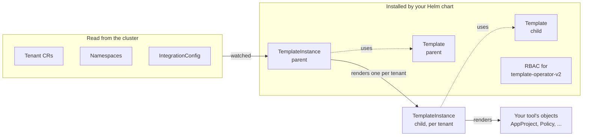
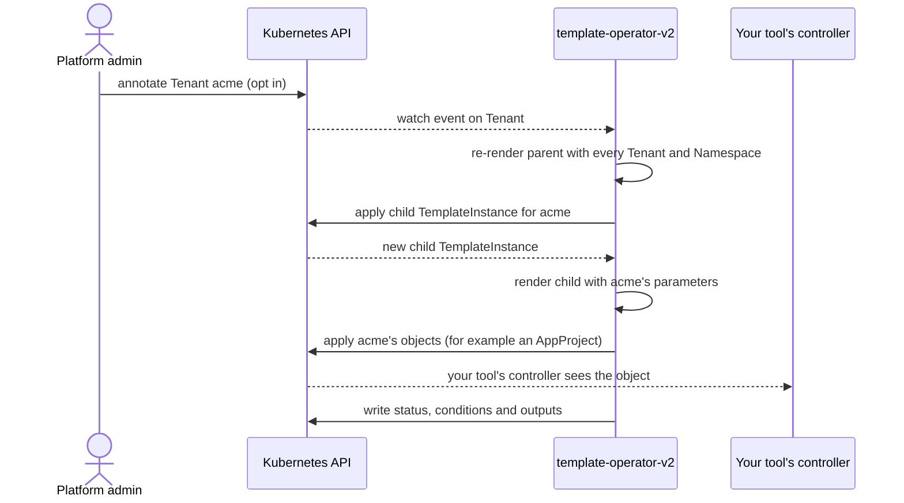

# Build your own extension

The extensions in this section, such as [ArgoCD](../argocd.md) and [Vault](../vault/vault.md), carry a tenant into a tool around the cluster. If your tool is not on the list, you can build the extension yourself, the same way Stakater builds its own.

An MTO extension is a Helm chart. It does not include an operator, a container image or a controller. The chart installs a few objects for [template-operator-v2](#template-operator-v2), and template-operator-v2 does the rest. It reads your `Tenant` resources, renders the objects your tool needs for each tenant, and keeps them in step as tenants change.

Stakater's ArgoCD and Vault Enterprise extensions are built this way, and this section is drawn from them.

## Is an extension the right tool?

An extension renders **Kubernetes objects**. It fits when the tool you are integrating is configured through Kubernetes resources:

| The tool is configured by | Example | Extension? |
|---|---|---|
| Its own CRDs, read by its own controller | ArgoCD `AppProject`, Grafana operator `GrafanaFolder`, Kyverno `Policy` | Yes. Render the CRs directly. |
| An API, with an operator that maps CRs onto it | Vault through [`vault-config-operator`](https://github.com/redhat-cop/vault-config-operator), Keycloak through its config operator | Yes. Render that operator's CRs. |
| Plain Kubernetes objects | `ConfigMap`, `NetworkPolicy`, `RoleBinding` in each tenant namespace | Yes, but first check whether MTO itself or a plain Template already does it. |
| Only an HTTP API, with no operator in front of it | A SaaS product's REST API | Not on its own. template-operator-v2 only talks to the Kubernetes API, so something has to turn objects into API calls. |

The [Extensions concept page](../../concepts/extensions.md) describes the other ways MTO reaches outside the cluster.

## How an extension works

An extension is built from two Templates. The **parent** reads the cluster and emits one **child** TemplateInstance for each tenant. The child renders that tenant's objects.

| Object | Installed by | Role |
|---|---|---|
| Parent `Template` | your chart | A Go template that ranges over every `Tenant` and emits one child `TemplateInstance` per tenant that should get the extension. |
| Parent `TemplateInstance` | your chart | The only instance you install. Its parameters read Tenants, Namespaces and anything else the parent needs, and template-operator-v2 watches them. |
| Child `Template` | your chart | Renders one tenant's objects from parameters the parent sets. |
| Child `TemplateInstance` | the parent | One per tenant. You never write these. |
| RBAC | your chart | What template-operator-v2 may read and write for this extension. By default it can only manage Templates and TemplateInstances and read Namespaces. |

What happens when a tenant changes:

Why two levels instead of one Template that renders everything:

- **One tenant's failure stays with that tenant.** If a tenant has a malformed annotation, only its child fails. Every other tenant keeps reconciling.
- **The watch count does not grow with tenants.** The parent holds a few cluster-wide watches, such as all Tenants and all Namespaces, however many tenants there are.
- **Status per tenant.** Each child TemplateInstance reports its own conditions, so you can see which tenant is broken and why.
- **Changes stay small.** A namespace event that affects one tenant rewrites only that tenant's child.

## Two ways to write the child

The child renders one tenant's objects. It can do that in either of two ways.

| | Inline gotemplate | Helm chart |
|---|---|---|
| The child `Template` holds | `spec.gotemplate`: a Go template | `spec.helm`: a reference to a published chart, plus `valuesTemplate` |
| Good for | A handful of objects per tenant | Many objects per tenant, or logic you already have as a chart |
| Updating it | Upgrade the extension chart | Publish a new tenant chart, then bump the version the child references |
| Used by | ArgoCD (one `AppProject` per tenant) | Vault Enterprise (two dozen or more `vault-config-operator` CRs per tenant) |

Start with an inline gotemplate. The [tutorial](tutorial.md) uses one, and [Real extensions](real-extensions.md) shows both.

## Requirements

| Component | Version |
|---|---|
| template-operator-v2 | 0.0.8. MTO 1.10 deploys it when the IntegrationConfig sets `components.templateOperatorV2.mode: Managed`. It is also available as a public chart. See [Installing template-operator-v2](template-operator-essentials.md#installing-template-operator-v2). |
| Kubernetes | 1.33 or later tested. template-operator-v2's CRDs do not install on 1.31. On OpenShift, 4.20 matches. |
| MTO | 1.10 tested, with `Tenant` at `tenantoperator.stakater.com/v1beta3`. |
| Helm | 3, to install the chart. |

!!! warning "An alpha API"
    template-operator-v2's API is `templates.v2.stakater.com/v2alpha1`, and its behaviour has changed between releases. For example, 0.0.8 started rendering with `missingkey=error`, and how objects are retained on deletion changed in 0.0.7. Pin the template-operator-v2 version you test against, write it down in your chart, and rerun your tests before you upgrade it.

## template-operator-v2

template-operator-v2 is Stakater's Template Operator, version 2. It is a separate operator from MTO, with its own `Template` and `TemplateInstance` kinds in the `templates.v2.stakater.com` group. The Templates section of these docs covers the earlier `templates.stakater.com/v1alpha1` API. That is a different API, and nothing on these pages applies to it.

[Template Operator essentials](template-operator-essentials.md) covers everything about template-operator-v2 that you need to write an extension.

## In this section

1. [Template Operator essentials](template-operator-essentials.md): the parts of template-operator-v2 that an extension uses, and how they behave.
1. [Tutorial: your first extension](tutorial.md): build, install and test a working extension on a local cluster.
1. [Design rules](design-rules.md): the rules that keep an extension safe in production, and how to test one.
1. [Real extensions](real-extensions.md): how the ArgoCD and Vault Enterprise extensions are built.
