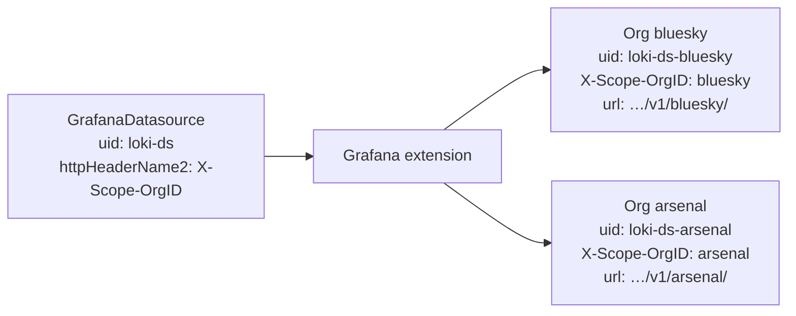
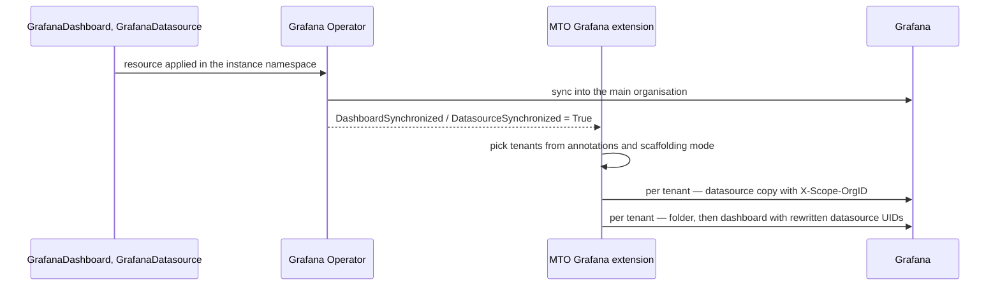
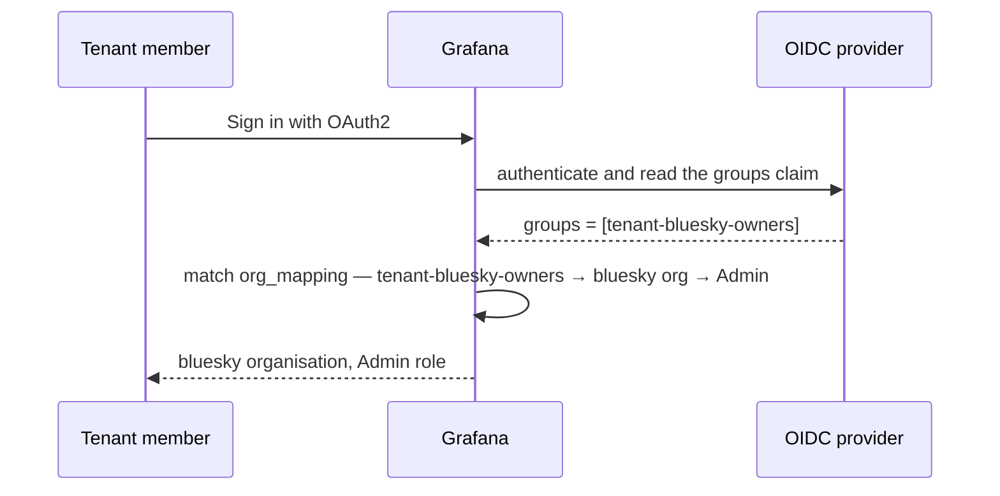

# Giving a tenant a dashboard

This is the path most people take, and everything else in this section builds on it: create the tenant, add a data source once for the whole cluster, add a dashboard, sign in as a tenant member. The examples use tenant `bluesky` and a Grafana instance in namespace `telemetry`.

## 1. Create the tenant

Administrators create a tenant as usual — no Grafana-specific fields are involved:

```yaml
apiVersion: tenantoperator.stakater.com/v1beta3
kind: Tenant
metadata:
  name: bluesky
spec:
  quota: small
  accessControl:
    owners:
      groups:
        - bluesky-owner-group
  namespaces:
    withTenantPrefix:
      - dev
```

Within one reconcile the extension creates a Grafana organisation named `bluesky` and adds its entries to the OAuth org mapping, so `tenant-bluesky-owners`, `tenant-bluesky-editors` and `tenant-bluesky-viewers` now resolve to that organisation.

Confirm it, here and after every later step — the extension reports per-tenant progress in its own status:

```bash
kubectl get grafana mto-extension-grafana -n mto-extension-grafana-system \
  -o jsonpath='{.status.tenantStatus.details}'
```

An entry for `bluesky` with a recent `lastSyncTime` and no `error` means the tenant is fully reconciled.

## 2. Add a data source, once, for every tenant

Write one `GrafanaDatasource` in the Grafana instance's namespace. The extension turns it into one tenant-scoped copy per organisation.

**Any data source type works.** The extension does not care what it is querying — if the data source carries an `X-Scope-OrgID` header slot, it can be partitioned per tenant. A typical platform runs three of them side by side, and two types get extra handling:

| Type | What the extension does | Worth knowing |
|:---|:---|:---|
| Any type with the header | UID becomes `<base>-<tenant>`, and the header value becomes the tenant name | The baseline for every type |
| `loki` | Also rewrites the **last path segment of the URL** to the tenant name | Matches Loki's per-tenant path convention |
| `tempo` | Also becomes eligible for the cross-tenant union data source in aggregated views | Tempo is the only type that gets a union data source |

Mimir is the one to watch: there is no `mimir` data source type. Use `type: prometheus` and set `jsonData.prometheusType: Mimir`.

The worked example below uses Loki, because it exercises the most — header injection *and* the URL rewrite. Mimir and Tempo follow the same shape:

```yaml
apiVersion: grafana.integreatly.org/v1beta1
kind: GrafanaDatasource
metadata:
  name: loki-datasource
  namespace: telemetry              # must be spec.server.namespace
spec:
  allowCrossNamespaceImport: true   # required
  resyncPeriod: 10m
  valuesFrom:
    - targetPath: "secureJsonData.httpHeaderValue1"
      valueFrom:
        secretKeyRef:
          name: grafana-auth-token
          key: token
  datasource:
    uid: loki-ds                    # required
    name: Loki
    type: loki
    access: proxy
    url: https://loki-gateway:8080/api/logs/v1/application/
    jsonData:
      httpHeaderName1: "Authorization"
      httpHeaderName2: "X-Scope-OrgID"   # required
    secureJsonData:
      httpHeaderValue1: "Bearer ${token}"
      # httpHeaderValue2 is filled in by the extension with the tenant name
```

Three things are required, and are the usual reason a data source never appears:

- **`spec.allowCrossNamespaceImport: true`.** The extension skips any data source without it — which is also how you keep a data source in that namespace outside MTO's control.
- **A non-empty, unique `spec.datasource.uid`.** Grafana caps a UID at 40 characters and the per-tenant copy is `<base>-<tenant>`; if that would run over, the extension keeps a readable prefix and appends a short hash rather than failing. A short base UID simply keeps the derived ones legible. A duplicate UID — or a duplicate data source name — is resolved in favour of the oldest resource, and the newer one is skipped with an error in status.
- **An `httpHeaderName<N>` entry whose value is exactly `X-Scope-OrgID`.** That is the slot the tenant name goes into; without it the data source cannot be scoped and is skipped.

The Grafana Operator must also have set `DatasourceSynchronized=True` on the resource before the extension picks it up.



*One definition, one copy per organisation. For every type the UID gains a tenant suffix and the `X-Scope-OrgID` header takes the tenant name; Loki alone also gets the tenant in its URL path.*

So in the `bluesky` organisation this yields UID `loki-ds-bluesky`, header `X-Scope-OrgID: bluesky`, and URL `…/api/logs/v1/bluesky/`. The data source's **name** is untouched, so it still reads as plain `Loki` to everyone inside the organisation.

To see it, switch to the `bluesky` organisation in Grafana, or list that organisation's data sources over the API — the same org-scoped call the extension itself makes, using the admin credentials from the instance's `<grafana-instance-name>-admin-credentials` secret:

```bash
curl -su "$GF_USER:$GF_PASS" -H "X-Grafana-Org-Id: <bluesky-org-id>" \
  http://grafana-service.telemetry.svc:3000/api/datasources
```

### Metrics and traces alongside logs

Mimir and Tempo need only the `datasource` block swapped. Everything else — `allowCrossNamespaceImport`, the header slot, `valuesFrom` — is identical:

```yaml
  # Mimir: there is no "mimir" type — use prometheus, and say so in jsonData
  datasource:
    uid: mimir-ds
    name: Mimir
    type: prometheus
    access: proxy
    url: http://mimir-nginx.mimir.svc/prometheus
    jsonData:
      httpHeaderName1: "Authorization"
      httpHeaderName2: "X-Scope-OrgID"
      prometheusType: Mimir
      httpMethod: POST
```

```yaml
  # Tempo: the only type eligible for the cross-tenant union datasource
  datasource:
    uid: tempo-ds
    name: Tempo
    type: tempo
    access: proxy
    url: http://tempo.tempo.svc:3200
    jsonData:
      httpHeaderName1: "Authorization"
      httpHeaderName2: "X-Scope-OrgID"
```

!!! warning
    Data sources that link to each other by UID — Tempo's `tracesToLogsV2`, `tracesToMetrics`, `lokiSearch` and `serviceMap`, or Prometheus `exemplarTraceIdDestinations` — are **not** rewritten. The extension tenant-scopes a data source's own UID, but nested `datasourceUid` values inside `jsonData` are copied through unchanged, so a reference to `loki-ds` stays `loki-ds` in every tenant organisation, where the data source is really `loki-ds-<tenant>`. Trace-to-logs and exemplar jumps will not resolve there. Dashboard panels are unaffected — those references *are* rewritten.

## 3. Add a dashboard

```yaml
apiVersion: grafana.integreatly.org/v1beta1
kind: GrafanaDashboard
metadata:
  name: loki-dashboard
  namespace: telemetry              # must be spec.server.namespace
spec:
  allowCrossNamespaceImport: true   # required
  resyncPeriod: 10m
  folderRef: platform-folder        # optional; a GrafanaFolder in this namespace
  json: |
    {
      "uid": "loki-overview",
      "title": "Loki Overview",
      "panels": [
        {
          "title": "Log Volume",
          "type": "timeseries",
          "datasource": { "type": "loki", "uid": "loki-ds" },
          "targets": [
            {
              "datasource": { "type": "loki", "uid": "loki-ds" },
              "expr": "sum(rate({job=\"app\"}[5m]))"
            }
          ]
        }
      ]
    }
```

A dashboard needs:

- `allowCrossNamespaceImport: true`;
- a UID, from either `spec.customUID` or the `uid` field in the JSON — `customUID` wins if both are set;
- `DashboardSynchronized=True` from the Grafana Operator.

**Reference data sources in object form** — `{"type": ..., "uid": ...}` — using the same base UID as the `GrafanaDatasource`. The extension then rewrites `loki-ds` to `loki-ds-bluesky` in the bluesky copy, and to each other tenant's UID in theirs.

- If the UID matches no managed data source, it falls back to matching on `type`, which only resolves when exactly one managed data source has that type. With two, the reference is left alone, and a warning is logged.
- String references such as `"-- Grafana --"` or `"${DS_PROMETHEUS}"` are left untouched.

**For folders, prefer `spec.folderRef` over `spec.folderUID`.** Both need a `GrafanaFolder` resource to exist — the Grafana Operator will not mark the dashboard synchronized otherwise — but `folderRef` names the dependency instead of implying it through a matching UID. The extension creates the folder, with its title, in a tenant's organisation the first time a dashboard referencing it is synced there.

Every dashboard the extension writes also carries an `mto-grafana-managed` tag. Orphan cleanup deletes only dashboards carrying it, which is exactly why a dashboard you create by hand in the Grafana UI is safe from the operator, in any folder.



## 4. Sign in as a tenant member

A user whose token carries `tenant-bluesky-owners` signs in through OIDC and lands in the `bluesky` organisation as Admin, seeing the dashboard with its panels already querying bluesky's data.



If the same user also carried `tenant-arsenal-viewers`, they would additionally have Viewer in the `arsenal` organisation and could switch between the two. How that mapping is built is covered in [Tenant access and roles](tenant-access-and-roles.md).

---

**Previous:** [Installation](installation.md) · **Next:** [Tenant access and roles](tenant-access-and-roles.md)
