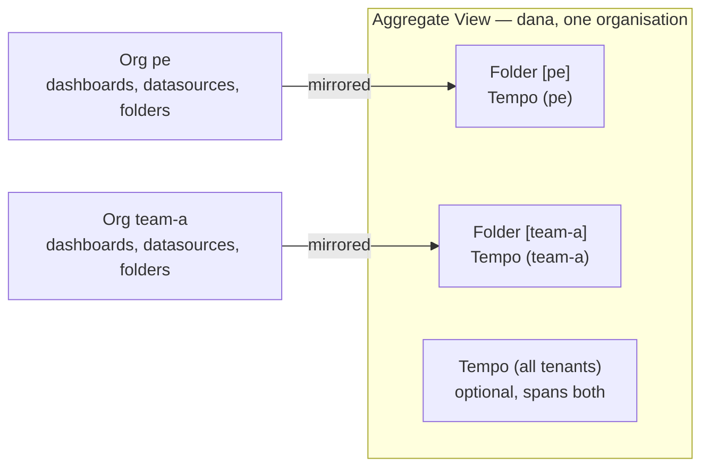
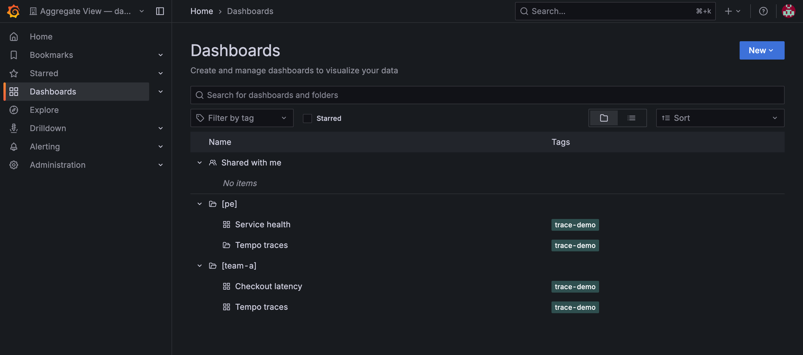
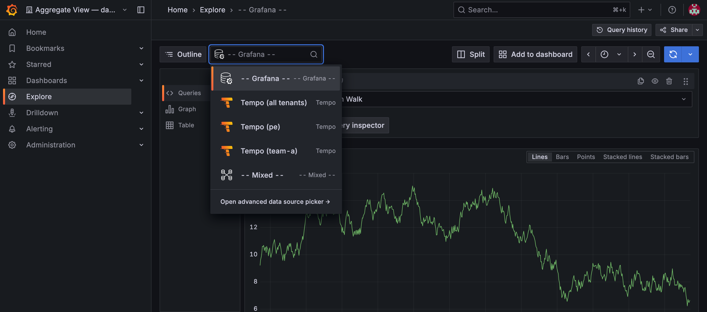

# Tenant access and roles

Access is decided by the identity-provider groups in the user's token. For each tenant, the extension renders a group name from a pattern and writes an OAuth org-mapping entry pointing that group at the tenant's organisation with a Grafana role.

| Tenant role | Default group pattern | Grafana role | Where it applies |
|:---|:---|:---|:---|
| Owner | `tenant-<tenant>-owners` | Admin | The tenant's organisation |
| Editor | `tenant-<tenant>-editors` | Editor | The tenant's organisation |
| Viewer | `tenant-<tenant>-viewers` | Viewer | The tenant's organisation |
| Cluster administrator | `clusteradmin \|\| cluster-admin` | Grafana server administrator | Every organisation |

For tenant `pe`, a user whose token carries `tenant-pe-editors` gets **Editor** in the **pe** organisation. Someone carrying `tenant-pe-owners` and `tenant-team-a-viewers` gets Admin in one and Viewer in the other, in the same session.

!!! note
    Grafana access follows the **group names your identity provider emits**, not the `accessControl` lists on the `Tenant` resource. The extension builds the expected group name from the tenant name and the `pattern` field — it does not read the tenant's `users` or `groups` entries. If your identity provider names groups differently, change `pattern` rather than the tenant.

!!! note
    The default `fallback: deny` is easy to misread: it does not block the login. The extension sets `roleAttributeStrict: false` on purpose, so a user whose real roles arrive through `org_mapping` is never locked out. What `deny` means is that a user matching no pattern gets no server-level role and no tenant organisation — they can sign in, and find nothing there.

## One organisation across a user's tenants

Isolation has a cost, and it falls on the people who cross tenants: platform engineers, on-call responders, anyone who owns several services. Grafana shows one organisation at a time, so answering "which of my six tenants is unhealthy?" means visiting six organisations one after another — during an incident, at the worst possible moment.

Aggregated views remove that. Each user gets one extra organisation, `Aggregate View — <login>`, mirroring the dashboards, data sources and folders of every tenant they belong to — everything they are entitled to see, on one screen, with nothing they are not. Enable `unionTraceDatasource` as well and a single distributed trace can be followed across tenant boundaries, which no per-tenant data source can do.



*Content is copied in from each tenant the user belongs to, and labelled with where it came from. The union trace data source is the one thing that is not a copy of anything — it spans the whole view.*

Everything inside it is labelled by origin, so it stays obvious which tenant a panel is reading from. Each tenant's dashboards land in their own folder, titled from `folderPrefix` — which is what keeps two tenants' copies of the same platform dashboard apart:



*One user's aggregated view. Each folder holds that tenant's own dashboard — `Service health` for `pe`, `Checkout latency` for `team-a` — alongside `Tempo traces`, which both tenants run and which therefore appears twice. The `[pe]` and `[team-a]` prefixes are the only thing telling the two copies apart.*

Data sources are labelled the same way: every mirror carries its tenant as a suffix, whatever its type — `Tempo (pe)`, `Tempo (team-a)`, and a `Mimir (pe)` or `Loki (pe)` alongside them if those tenants have such data sources. The optional cross-tenant data source is Tempo only, and is named `Tempo (all tenants)`.

```yaml
spec:
  aggregatedViews:
    enabled: true
    folderPrefix: "[{{ .Tenant }}] "     # optional
    useMinTenantRole: false              # optional
    mirrorManualDashboards: false        # optional
    shareUserDashboards: false           # optional
    unionTraceDatasource:                # optional
      enabled: false
```

| Field | Default | What it does |
|:---|:---|:---|
| `enabled` | `false` | Turns the feature on. Turning it off again leaves existing view organisations in place rather than deleting them. |
| `folderPrefix` | `[<tenant>]` and a trailing space | Title prefix for each tenant's folder inside the view. `{{ .Tenant }}` is the only variable. |
| `useMinTenantRole` | `false` | Viewer in the view by default. When `true`, the user gets the **lowest** of their tenant roles. |
| `mirrorManualDashboards` | `false` | Also mirror dashboards created by hand in a tenant organisation, not just those backed by a `GrafanaDashboard`. |
| `shareUserDashboards` | `false` | Share dashboards a user builds inside their own view with colleagues whose tenant access covers the same data. Needs `useMinTenantRole: true` to do anything — a Viewer cannot create a dashboard to share. |
| `unionTraceDatasource.enabled` | `false` | Add one cross-tenant Tempo data source to each view. |

### Roles inside the view

The default Viewer role is the safe choice, but Grafana **Explore** requires Editor or above, so ad-hoc queries and trace exploration are unavailable from the view until you set `useMinTenantRole: true`. That grants the **lowest** of the user's tenant roles, ranked Admin > Editor > Viewer:

- Admin in **every** tenant → Admin in the view.
- Editor in the weakest tenant → Editor in the view.
- Viewer in **any one** tenant → Viewer in the view. The most restrictive tenant wins.

So Explore becomes available to anyone whose weakest tenant role is Editor or better. Viewer is also the floor: an unrecognised role counts as Viewer, so a malformed membership can never promote someone. Grafana Editors cannot manage organisation membership, so none of this opens a path to cross-tenant content.

### Cross-tenant traces

Multi-tenant Tempo partitions traces by `X-Scope-OrgID`, so a per-tenant data source only ever returns one tenant's spans and a request crossing tenants cannot be followed end to end. Enabling `unionTraceDatasource` adds one `<name> (all tenants)` Tempo data source whose `X-Scope-OrgID` is the pipe-joined set of tenants already in that view, which Tempo merges on read.

- **Access-preserving by construction** — a view only ever contains the user's own tenants, so the union can never reach one they are not a member of.
- **Additive** — the per-tenant data sources stay.
- **Tempo only.** It needs a synchronized Tempo `GrafanaDatasource` carrying an `X-Scope-OrgID` header; one without is skipped with a warning.
- Users in a single tenant get no union data source, as it would duplicate their per-tenant copy.
- Pair it with `useMinTenantRole: true` to query it from Explore.



*Explore inside an aggregated view. The user can query either tenant on its own, or `Tempo (all tenants)` to follow one trace across both. Explore is available here at all because `useMinTenantRole` granted Editor — at the default Viewer it would be closed.*

### What mirrored content does and does not allow

Mirrored content is operator-owned and read-oriented:

- Mirror **data sources** are re-asserted every cycle, so a manual edit is undone within one reconcile.
- Mirror **dashboards** are hash-compared and only re-pushed when the source changes. That avoids reloading everyone's browser each cycle, but it also means an edit saved to a mirror survives until the source changes or the mirror is deleted.
- Make changes in the tenant organisation or in Git; they flow into every view that mirrors them.

The view follows the user's access:

- Losing access to a tenant removes that tenant's content from the view.
- Losing every tenant makes the view eligible for removal after a grace period — but a view holding dashboards the user created themselves is kept for manual review.
- Per-user state, including content counts and last sync time, is reported under `status.aggregatedViews`.

---

**Previous:** [Giving a tenant a dashboard](giving-a-tenant-a-dashboard.md) · **Next:** [Choosing which tenants get a resource](choosing-which-tenants.md)
