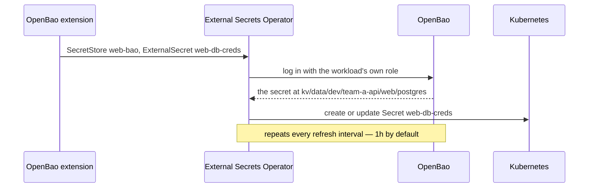
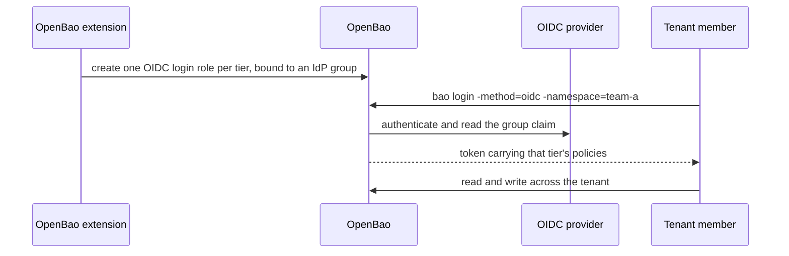

# Delivery and login

External Secrets delivers secrets to workloads as Kubernetes `Secret`s, and human SSO lets tenant members sign in to OpenBao.

## Delivering secrets as Kubernetes Secrets

Most applications should not call OpenBao at all. With the [External Secrets Operator](https://external-secrets.io/) (ESO), on by default, the extension wires up delivery: ESO logs into OpenBao for the workload, fetches the secret and keeps an ordinary Kubernetes `Secret` in sync with it.

For each ServiceAccount you give a tier, the extension creates a `SecretStore` named `<serviceaccount>-bao` that logs in with the same role as the workload. You then request secrets with annotations on the **Deployment** — each produces one Kubernetes `Secret`, named `<serviceaccount>-<name>`:

```yaml
apiVersion: apps/v1
kind: Deployment
metadata:
  name: web
  namespace: team-a-api
  annotations:
    bao.stakater.com/kv-secret.db-creds: postgres        # the whole secret
    bao.stakater.com/kv-secret.api-key: external#token   # just the "token" field
spec:
  template:
    spec:
      serviceAccountName: web
      containers:
        - name: web
          image: my/web:1.0
          envFrom:
            - secretRef:
                name: web-db-creds
```

The value is `<leaf>[#<field>]`: with `#<field>`, only that field is copied into the `Secret`; without it, every field becomes a key.



The workload mounts the `Secret` and never learns OpenBao exists. Two more annotations cover the sharing cases: `bao.stakater.com/kv-subscribe.<name>` reads from a sibling namespace's shared folder, and `bao.stakater.com/kv-import.<name>` reads from another tenant (prefixed with the source, e.g. `team-a-api/postgres`, `team-a/creds`). Each needs the matching grant on the ServiceAccount — see [Secrets and sharing](secrets-and-sharing.md).

!!! note
    Every refresh is an OpenBao login. The default interval is one hour, and every workload logs in on it, so shortening the interval multiplies the load on OpenBao by the number of workloads.

## Human login

With `sso.enabled`, people sign in to OpenBao through your identity provider and their access follows their groups. For each tier, the extension creates a login role bound to an identity-provider group named `<tenant>-<tier>s` by default — so members of `team-a-admins` get the `admin` tier in `team-a`. Unlike a workload, which is confined to one namespace, a signed-in person gets that tier across the whole tenant.



```bash
bao login -method=oidc -namespace=team-a role=sso-team-a-admin
```

Sessions are short — 15 minutes by default, 1 hour at most — because removing someone from a group in the identity provider does not revoke tokens already issued.

---

**Previous:** [Encryption and certificates](encryption-and-certificates.md) · **Next:** [Security](security.md)
