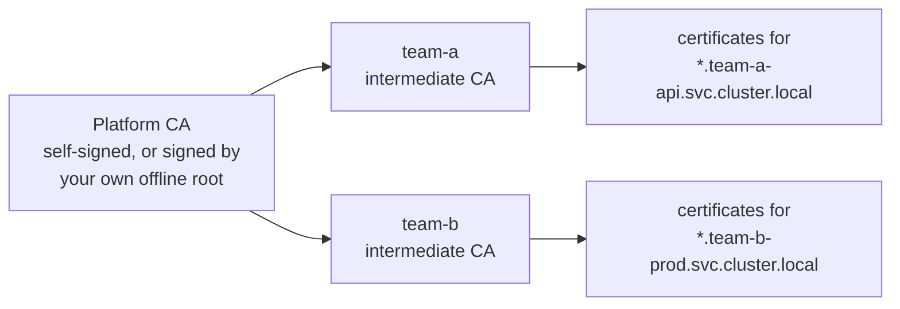

# Encryption and certificates

Two engines beyond KV: transit for encryption, PKI for certificates. Both are reached the same way as KV — one login with the ServiceAccount token, then the paths from the `ConfigMap`.

## Encrypting data (transit)

Add `bao.stakater.com/transit: "true"` alongside an `editor` or `admin` tier, and the workload gets three encryption keys: one private to the application, one shared by every opted-in application in its namespace, and one shared across the tenant. Keys rotate every 90 days by default and never leave OpenBao.

The `ConfigMap` carries each key's encrypt and decrypt endpoints, so encrypting is one call:

```bash
curl -s --request POST \
  --header "X-Vault-Token: ${VAULT_TOKEN}" \
  --header "X-Vault-Namespace: ${VAULT_NAMESPACE}" \
  --data '{"plaintext":"'"$(echo -n 'hello' | base64)"'"}' \
  "${VAULT_ADDR}/v1/${VAULT_TRANSIT_APP_ENCRYPT}"
```

Two workloads that must exchange encrypted data use the tenant-shared key on both sides. Across tenants, `transit-export-tenant` and `transit-import-tenant` create one key per pair: the exporter may encrypt and decrypt, the importer may only decrypt.

## Issuing certificates (PKI)

Each tenant gets its own certificate authority — by default an intermediate signed by a cluster-wide platform CA, so every tenant's certificates chain back to a single anchor. Trusting another tenant is still opt-in; the anchor alone grants nothing.



The shipped role issues certificates for `*.svc.cluster.local` names in the tenant's own namespaces, valid for 7 days.

### Through cert-manager (recommended)

Turn on `parent.certManager.enabled` and each opted-in namespace gets an `Issuer` named after the tenant's certificate role. Applications then request certificates the normal way, and the private key is generated in the cluster and never sent to OpenBao:

```yaml
apiVersion: cert-manager.io/v1
kind: Certificate
metadata:
  name: web-tls
  namespace: team-a-api
spec:
  secretName: web-tls
  issuerRef:
    name: team-a-svc
    kind: Issuer
  commonName: web.team-a-api.svc.cluster.local   # required
  dnsNames:
    - web.team-a-api.svc.cluster.local
```

!!! note
    `commonName` is not optional. A `Certificate` carrying only `dnsNames` is refused at signing time; it sits at `Ready=False`, and the reason appears on the `CertificateRequest`, not on the `Certificate`.

### Directly from OpenBao

With `bao.stakater.com/pki: "true"` on the ServiceAccount, the `ConfigMap` offers two endpoints: `VAULT_PKI_SIGN_PATH`, where you send a certificate signing request and the private key never leaves the pod, and `VAULT_PKI_ISSUE_PATH`, where OpenBao generates the key and returns it over the network. **Prefer signing.**

### Cross-tenant trust

Namespaces in one tenant share a CA, so they already trust one another. Across tenants, trust is opt-in and decided by the consuming side:

- `bao.stakater.com/pki-trust-tenant` — trust a peer's **server** certificates when you call it.
- `bao.stakater.com/pki-allow-tenant` — accept that peer as a **client** calling you.

Accepting implies trusting; trusting never implies accepting.

---

**Previous:** [Secrets and sharing](secrets-and-sharing.md) · **Next:** [Delivery and login](delivery-and-login.md)
