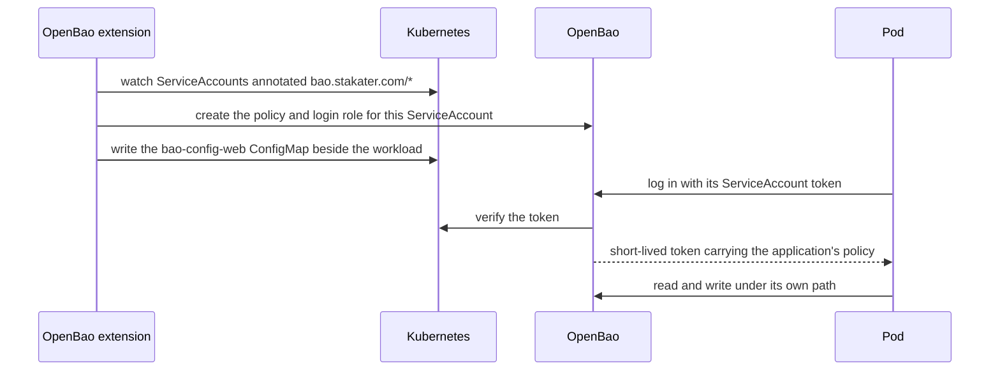
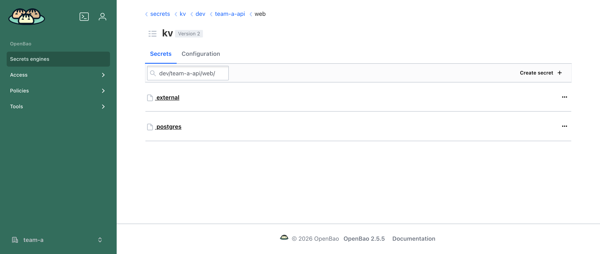

# Giving an application a secret

This is the path most people take, and everything else builds on it: annotate the workload, write a secret, read it from a pod. The examples use tenant `team-a` and its namespace `team-a-api`, created the ordinary way — see [Creating a tenant](../../guides/create-tenant.md). Nothing about the `Tenant` is OpenBao-specific.

## 1. Annotate the ServiceAccount

The ServiceAccount is the identity OpenBao authenticates, so this is where access is granted. Name the engine you want, and the tier to grant it at:

```yaml
apiVersion: v1
kind: ServiceAccount
metadata:
  name: web
  namespace: team-a-api
  annotations:
    bao.stakater.com/kv: "true"
    bao.stakater.com/tier: editor
```

`tier` is required alongside any engine — an engine annotation on its own grants nothing. For ServiceAccount `web`, this creates:

- an OpenBao policy scoped to that application's own path, `kv/data/dev/team-a-api/web/*`;
- a Kubernetes auth role, so the pod can trade its ServiceAccount token for a short-lived OpenBao token;
- a `ConfigMap` named `bao-config-web` in `team-a-api`, holding every address, role and path the workload needs.

The last path segment is the **application**, which defaults to the ServiceAccount name. Scoping to the application rather than the namespace is what stops two workloads in one namespace reading each other's secrets.



## 2. Write the first secret

Someone has to write the first secret, which means knowing the path. The `bao-apps` `ConfigMap` answers that — every namespace with at least one OpenBao-enabled ServiceAccount has one, an entry per application:

```console
$ kubectl get cm bao-apps -n team-a-api -o jsonpath='{.data.web}'
serviceAccount: "web"
tier: "editor"
engines: kv
kvPath: kv/data/dev/team-a-api/web/
```

A person signed in through OIDC, or a pipeline with its own credentials, writes to that path:

```bash
bao login -method=oidc -namespace=team-a role=sso-team-a-admin
bao kv put -mount=kv dev/team-a-api/web/postgres username=app password=s3cr3t
```

In the OpenBao web UI, open the `kv` mount and browse `dev/team-a-api/web/`. The `/data/` segment in `kvPath` is an API artefact and does not appear in the UI.



## 3. Read the secret from the pod

Load the `ConfigMap` into the pod, and everything the workload needs is in its environment:

```yaml
apiVersion: apps/v1
kind: Deployment
metadata:
  name: web
  namespace: team-a-api
spec:
  template:
    spec:
      serviceAccountName: web
      containers:
        - name: web
          image: my/web:1.0
          envFrom:
            - configMapRef:
                name: bao-config-web
```

```bash
export VAULT_TOKEN=$(bao write -field=token auth/kubernetes/login \
  role="${VAULT_K8S_ROLE}" \
  jwt=@/var/run/secrets/kubernetes.io/serviceaccount/token)

bao read "${VAULT_KV_APP_PATH}postgres"
```

The `ConfigMap` always carries the server address, the tenant's OpenBao namespace, the login role and the application's own paths:

| Key | Example | Meaning |
|:---|:---|:---|
| `VAULT_ADDR` | `https://openbao.openbao:8200` | OpenBao server URL |
| `VAULT_NAMESPACE` | `team-a/` | the tenant's OpenBao namespace |
| `VAULT_K8S_ROLE` | `team-a-team-a-api-web` | the login role for this ServiceAccount |
| `VAULT_KV_APP_PATH` | `kv/data/dev/team-a-api/web/` | where this application's secrets live |
| `VAULT_KV_SHARED_OUT_PATH` | `kv/data/dev/_shared/from-team-a-api/` | the namespace's shared folder |

Read these from the `ConfigMap` rather than copying them into manifests — they differ per tenant and application. Transit and PKI add their own keys when enabled.

!!! note
    Every engine is reached the same way: one login with the ServiceAccount token, then the paths from the `ConfigMap`. Once you know it, transit and PKI need nothing new.

## Prefer delivery over in-app calls

Most applications should not call OpenBao at all — annotate the Deployment and the secret arrives as a Kubernetes `Secret` through External Secrets. See [Delivery and login](delivery-and-login.md). Use the in-pod calls above only when an app genuinely needs the OpenBao API.

---

**Previous:** [Installation](installation.md) · **Next:** [Secrets and sharing](secrets-and-sharing.md)
