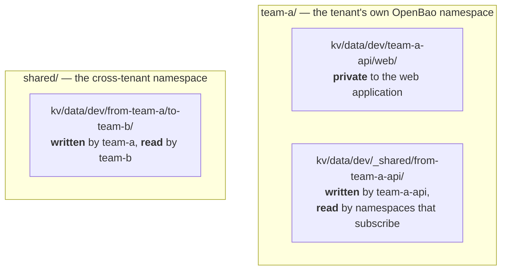

# Secrets and sharing

Each application has its own KV path. Sharing is opt-in on both sides, and the direction is fixed. There are three scopes, and the path tells you which one you are in:



## Between namespaces in one tenant

Each namespace owns a shared folder that only it can write to; other namespaces in the same tenant subscribe to read it. The folder is named after the writer, so a reader always knows where a value came from.

An `editor` or `admin` workload writes to its own folder with no extra annotation — the path is already in its `ConfigMap` as `VAULT_KV_SHARED_OUT_PATH`. The reader opts in:

```yaml
# a ServiceAccount in team-a-worker, reading what team-a-api shared
metadata:
  annotations:
    bao.stakater.com/tier: viewer
    bao.stakater.com/kv-subscribe-ns: team-a-api
```

Subscribing only ever grants read, so no namespace can write into another namespace's folder. You can only subscribe to namespaces in your own tenant.

## Between tenants

Cross-tenant secrets live in neither tenant. They go to the `shared/` OpenBao namespace, and both sides must opt in:

```yaml
# a team-a ServiceAccount — may write to team-b
bao.stakater.com/kv-export-tenant: team-b

# a team-b ServiceAccount — may read what team-a sent
bao.stakater.com/kv-import-tenant: team-a
```

Exporting grants nothing until the other tenant imports, and removing either annotation cuts the link.

!!! note "Delivering a shared secret"
    These grants (on the ServiceAccount) open the path. To deliver a shared or imported secret to a workload as a Kubernetes `Secret`, pair them with the `kv-subscribe.<name>` / `kv-import.<name>` request annotations on the Deployment — see [Delivery and login](delivery-and-login.md).

---

**Previous:** [Giving an application a secret](giving-an-application-a-secret.md) · **Next:** [Encryption and certificates](encryption-and-certificates.md)
