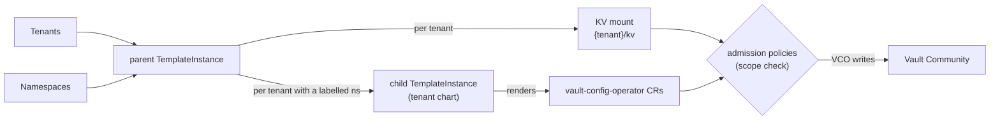

# Overview

Give every tenant its own **secret scope in one shared Vault Community Edition** — a KV secrets engine, Kubernetes login, per-application policies and (optionally) human SSO and delivery as Kubernetes `Secret`s — derived from the `Tenant` you already maintain and kept in sync as it changes.

!!! note
    This is the Helm-chart Vault Community extension ([`mto-extension-vault-community`](https://github.com/stakater/mto-extension-vault-community)). It replaces the built-in Vault integration configured through the `IntegrationConfig`, now deprecated — see [the older integration](../vault/vault.md) and [Migrating](migrating.md). It is a port of the [Vault Enterprise](../vault-enterprise/overview.md) extension, with the same annotations, roles, object names and `ConfigMap` keys.

!!! warning "Requires Template Operator v2, VCO and Kubernetes 1.30"
    The extension is **configuration** — it installs no controller of its own. It renders [Template Operator v2](../../template-operator-v2/concepts/overview.md) objects (`templates.v2.stakater.com`), which in turn render [`vault-config-operator`](https://github.com/redhat-cop/vault-config-operator) (VCO) custom resources; VCO writes them to Vault. Both operators must be running, and the cluster must be Kubernetes 1.30 or later for the admission policies that guard every tenant. See [Installation](installation.md).

## At a glance

| You maintain | The extension keeps in sync |
|:---|:---|
| a `Tenant` | a KV v2 mount `<tenant>/kv` |
| namespaces labelled for it | a Kubernetes auth mount `auth/<tenant>/kubernetes/workloads` that workloads log in with |
| a ServiceAccount annotation per app | a policy + login role per app, scoped to its own KV path |
| (optional) a Deployment annotation | the secret delivered as a Kubernetes `Secret` via External Secrets |

**You write** — annotate a workload's ServiceAccount:

```yaml
apiVersion: v1
kind: ServiceAccount
metadata:
  name: checkout
  namespace: acme-shop            # a namespace labelled stakater.com/tenant: acme
  annotations:
    vault.stakater.com/kv: "true"      # give this app its own KV prefix
    vault.stakater.com/role: editor    # read + write there
```

**You get** — in Vault, created for you:

- a KV path the app can reach, `acme/kv/data/<env>/acme-shop/checkout/…`,
- a Vault policy and a Kubernetes login role `kv.acme.acme-shop.checkout` on the tenant's auth mount `auth/acme/kubernetes/workloads`,
- a `ConfigMap` `vault-config-checkout` in `acme-shop` with the `VAULT_*` values the app needs to log in and find its path.

The pod logs in with the ServiceAccount token Kubernetes already gives it — no static Vault credential.

## A tenant is a path prefix

Vault Community Edition has no namespaces. So the extension gives every tenant the paths the Enterprise extension uses, with the tenant's name in front, in Vault's one namespace:

| Vault Enterprise (in namespace `<tenant>`) | Vault Community (in root) |
|:---|:---|
| `kv/` | `<tenant>/kv/` |
| `auth/kubernetes/workloads/` | `auth/<tenant>/kubernetes/workloads/` |
| `auth/oidc/sso/` | `auth/<tenant>/oidc/sso/` |
| the shared namespace's `kv/` | `shared/kv/` |

Without a namespace around each tenant, **the policy is the only wall between tenants**. The extension writes every policy and role itself and checks each one twice: when it renders, and again at the Kubernetes API server through admission policies. See [Security](security.md).

## How it works



A **bootstrap chart** (installed once) runs the parent, which renders each tenant's KV mount itself and emits one child `TemplateInstance` per tenant that has a labelled namespace. Each child pulls the **tenant chart** and renders that tenant's VCO resources: its auth mounts, and a policy and login role per annotated ServiceAccount. The KV mount is rendered by the parent, so it lives as long as the `Tenant` — not as long as its namespaces.

## Who does what

| | Platform / Vault administrator | Tenant |
|:---|:---|:---|
| **Sets up once** | the Vault login for VCO; installs the bootstrap chart | — |
| **Per tenant** | nothing; purges a deleted tenant's secrets when it decides to | annotates ServiceAccounts/Deployments for the access each app needs |
| **Never** | writes per-tenant Vault policies by hand | holds a static Vault credential, writes a Vault policy, mount or auth role, or reaches another tenant's mount |

## How roles map to Vault access

A workload's `vault.stakater.com/role` sets what it may do on its KV paths:

| Role | KV capabilities |
|:---|:---|
| `audit-read` | list names only — no values |
| `viewer` | read, list |
| `editor` | create, read, update, patch, list |
| `admin` | editor, plus `delete` on data, and `delete`, `undelete` and `destroy` on versions |

Human SSO users get the same roles, from their identity-provider group — see [Delivery and login](delivery-and-login.md#human-sso). No role, `admin` included, can write a Vault policy, a mount or an auth role: tenants never administer Vault.

## Community, Enterprise or OpenBao

The three extensions give developers the same annotations, roles, names and `ConfigMap` keys. They differ in what isolates one tenant from another:

| Backend | A tenant is | Extension |
|:---|:---|:---|
| Vault Community | a path prefix: a KV mount, auth mounts, policies and login roles, every policy checked | this one |
| Vault Enterprise | a Vault namespace | [Vault Enterprise](../vault-enterprise/overview.md) |
| OpenBao | an OpenBao namespace | [OpenBao](../openbao/overview.md) |

Some things Community Edition cannot give each tenant: its own audit log, identity store or `default` policy, per-tenant quotas, or delegated administration. [Security → what Community Edition cannot isolate](security.md#what-community-edition-cannot-isolate) lists them. If you need them, use Vault Enterprise or OpenBao.

!!! info "Built on Template Operator v2"
    Because the extension renders through Template Operator v2, the permissions the bootstrap grants are shared with anyone who can author a `Template`. On a cluster where tenants (or others) can create Templates, read [Security → how the extension scopes Template Operator v2](security.md#how-the-extension-scopes-template-operator-v2) before production.

## In this section

1. [Installation](installation.md) — prerequisites, the one-time Vault bootstrap, install the bootstrap chart
1. [Giving an application a secret](giving-an-application-a-secret.md) — annotate a ServiceAccount, write and read a secret
1. [Secrets and sharing](secrets-and-sharing.md) — the KV layout, sharing within and between tenants
1. [Delivery and login](delivery-and-login.md) — Kubernetes `Secret`s via External Secrets, and human SSO
1. [Security](security.md) — the scope check, the admission policies, the trust boundary and the limits of Community Edition
1. [Operating](operating.md) — health, troubleshooting, deletion and purge, monitoring, uninstall
1. [Reference](reference.md) — bootstrap values, annotations, `ConfigMap` keys and names
1. [Migrating](migrating.md) — from the `IntegrationConfig` integration

---

**Next:** [Installation](installation.md)
