# On OpenShift

MTO is [RedHat Certified](https://catalog.redhat.com/en/software/container-stacks/detail/618fa05e3adfdfc43f73b126) operator available on the Red Hat Ecosystem Catalog.

This document contains instructions on installing, uninstalling and configuring Multi Tenant Operator on OpenShift.

1. [OpenShift Software Catalog UI](#installing-via-software-catalog-ui)

1. [CLI/GitOps](#installing-via-cli-or-gitops)

1. [Enabling Console](#enabling-console)

1. [Uninstall](#uninstall-via-software-catalog-ui)

## Requirements

* An **OpenShift** cluster

## Installing via Software Catalog UI

* After opening OpenShift console click on `Ecosystem`, followed by `Software Catalog` from the side menu

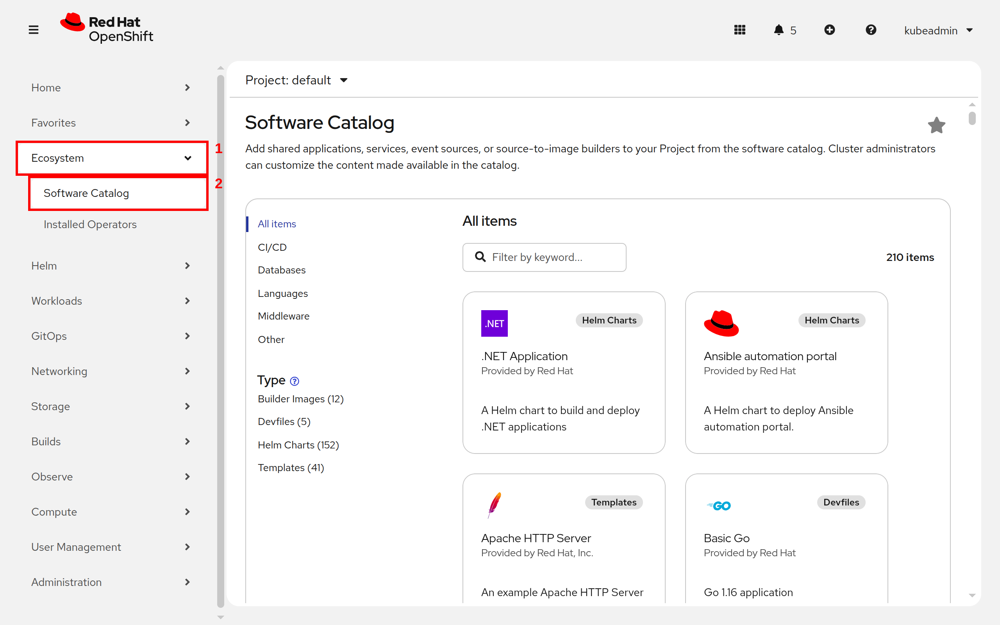

* Now search for `Multi Tenant Operator` and then click on `Multi Tenant Operator` tile

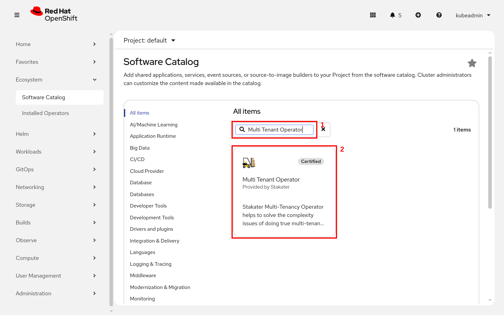

* Click on the `install` button

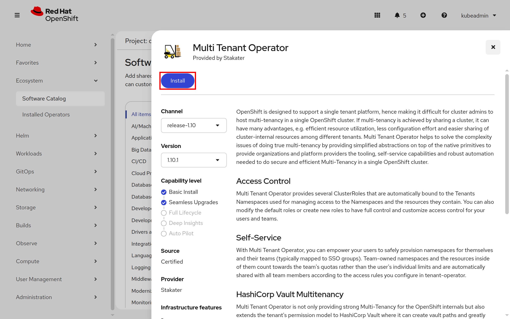

* Select `Update channel`. Select `multi-tenant-operator` to install the operator in `multi-tenant-operator` namespace under `Installed Namespace`. After configuring `Update approval` click on the `install` button.

> Note: Use the latest `release-1.x` channel for seamless upgrades. For `Production Environment` prefer `Manual` approval and use `Automatic` for `Development Environment`

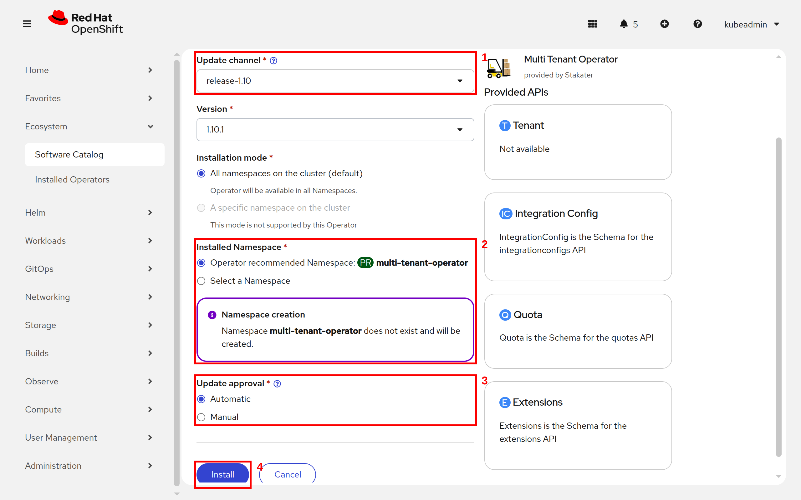

* Wait for the operator to be installed

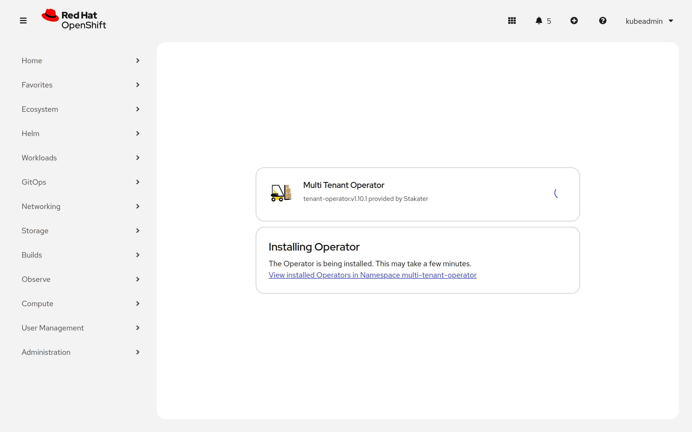

* Once successfully installed, MTO will be ready to enforce multi-tenancy in your cluster

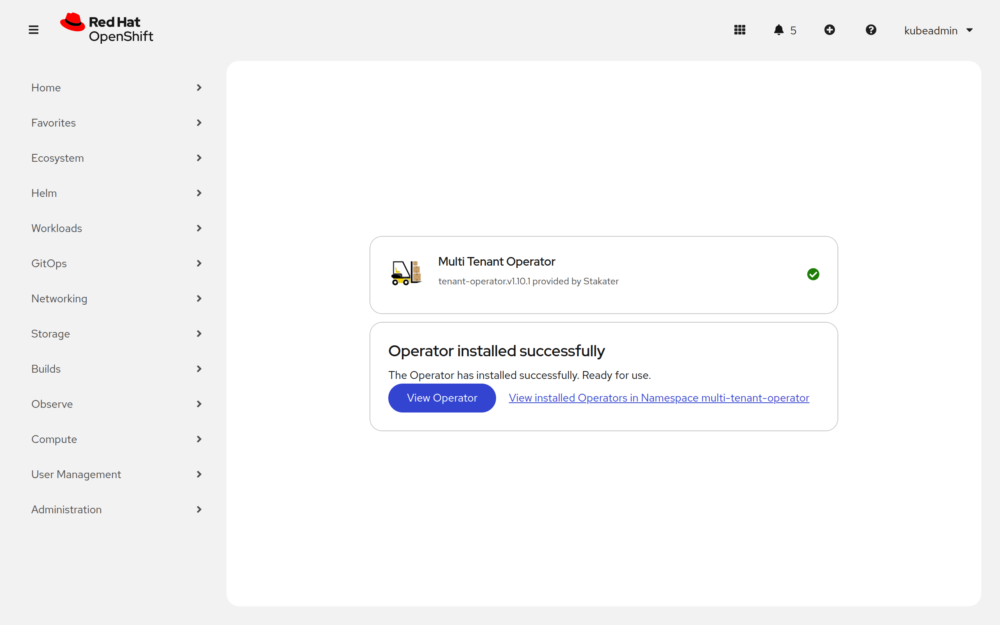

> Note: MTO will be installed in `multi-tenant-operator` namespace.

## Installing via CLI OR GitOps

* Create namespace `multi-tenant-operator`

```bash
oc create namespace multi-tenant-operator
namespace/multi-tenant-operator created
```

* Create an OperatorGroup YAML for MTO and apply it in `multi-tenant-operator` namespace.

```bash
oc create -f - << EOF
apiVersion: operators.coreos.com/v1
kind: OperatorGroup
metadata:
  name: tenant-operator
  namespace: multi-tenant-operator
EOF
operatorgroup.operators.coreos.com/tenant-operator created
```

* Create a subscription YAML for MTO and apply it in `multi-tenant-operator` namespace. To enable console set `.spec.config.env[].ENABLE_CONSOLE` to `true`. This will create a route resource, which can be used to access the Multi-Tenant-Operator console.

```bash
oc create -f - << EOF
apiVersion: operators.coreos.com/v1alpha1
kind: Subscription
metadata:
  name: tenant-operator
  namespace: multi-tenant-operator
spec:
  channel: release-1.10
  installPlanApproval: Automatic
  name: tenant-operator
  source: certified-operators
  sourceNamespace: openshift-marketplace
  startingCSV: tenant-operator.v1.10.1
EOF
subscription.operators.coreos.com/tenant-operator created
```

> Note: To bring MTO via GitOps, add the above files in GitOps repository.

* After creating the `subscription` custom resource open OpenShift console and click on `Ecosystem`, followed by `Installed Operators` from the side menu

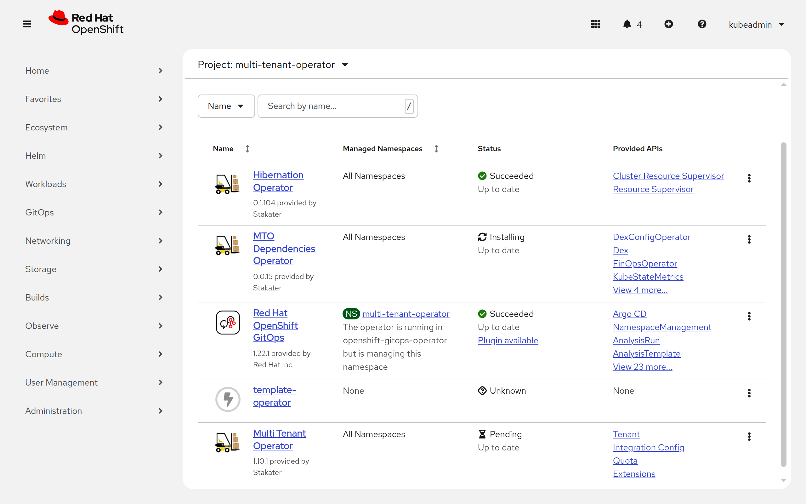

* Wait for the installation to complete

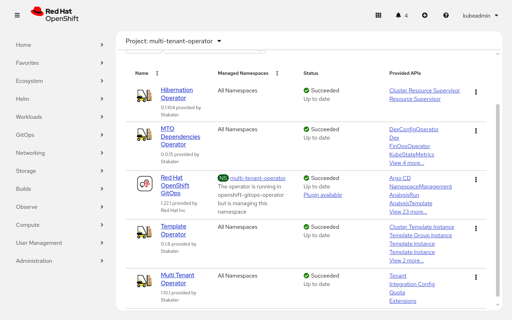

* Once the installation is complete click on `Workloads`, followed by `Pods` from the side menu and select `multi-tenant-operator` project

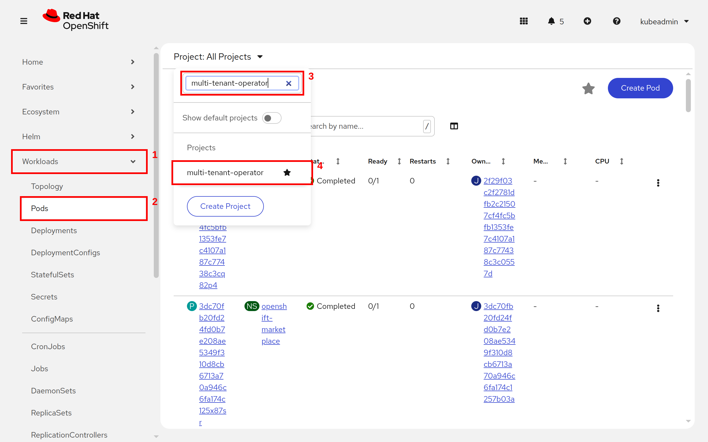

* Once pods are up and running, MTO will be ready to enforce multi-tenancy in your cluster

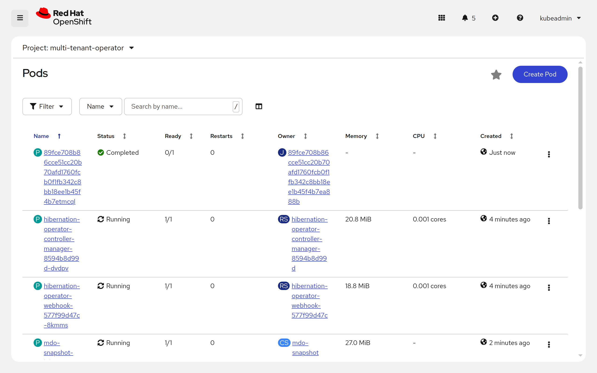

For more details and configurations check out [IntegrationConfig](../../concepts/integration-config.md).

## Enabling Console

To enable console GUI for MTO, go to `Search` -> `IntegrationConfig` -> `tenant-operator-config` and make sure the following fields are set to `true`:

```yaml
spec:
  components:
    console: true
    showback: true
```

> Note: If your `InstallPlan` approval is set to `Manual` then you will have to manually approve the `InstallPlan` for MTO to be installed.

### Manual Approval

* Open OpenShift console and click on `Ecosystem`, followed by `Installed Operators` from the side menu.

* Now click on `Upgrade available` in front of `tenant-operator`.

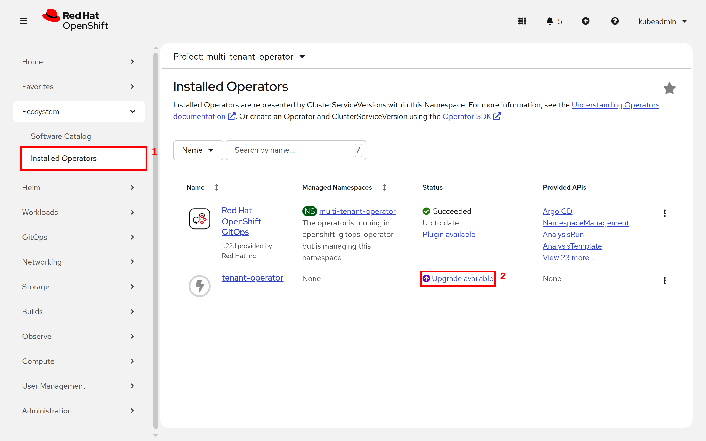

* Now click on `Preview InstallPlan` on top.

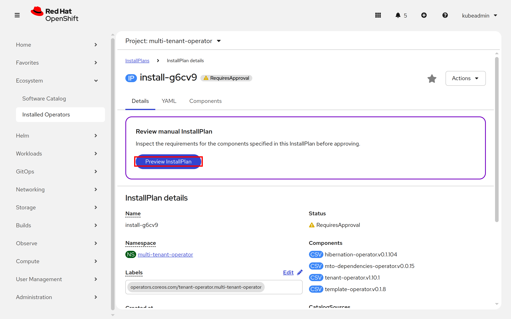

* Now click on `Approve` button.

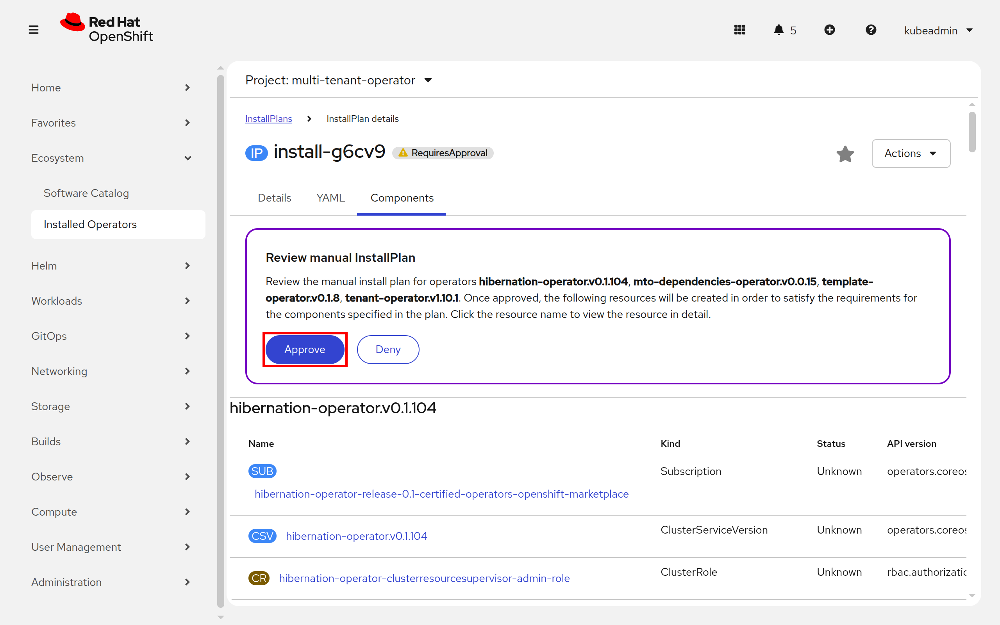

* Now the `InstallPlan` will be approved, and MTO will be installed.

### Console Admin Access

MTO ships with a default admin user, `mto`, that you can log in to the console with. It is not privileged out of the box, so add its email to the privileged users in the `IntegrationConfig` to give it administrator access:

```bash
oc patch integrationconfigs.tenantoperator.stakater.com tenant-operator-config \
  -n multi-tenant-operator --type=merge --patch '{
    "spec": {
        "accessControl": {
            "privileged": {
                "users": [
                    "mto@stakater.com"
                ]
            }
        }
    }
}'
```

Users listed under `spec.accessControl.privileged` can see every tenant and namespace in the console, along with the `IntegrationConfig` itself. For the other console roles, see [Configuration](../../console/configuration.md).

The `mto` account exists so you can sign in before an identity provider is connected. Remove it before the cluster goes to production; see [Remove the default admin login](../production-readiness.md#remove-the-default-admin-login).

## Uninstall via Software Catalog UI

You can uninstall MTO by following these steps:

* Decide whether to retain tenant namespaces and ArgoCD AppProjects. Set `spec.namespaces.onDeletePurgeNamespaces` to `false` on every tenant whose namespaces you want to keep, and `argoCD.onDeletePurgeAppProject` to `false` on its `Extensions` resource for every AppProject you want to keep. See [Delete a Tenant](../../guides/delete-tenant.md) and [Uninstalling MTO](../uninstalling.md).

* After making the required changes open OpenShift console and click on `Ecosystem`, followed by `Installed Operators` from the side menu

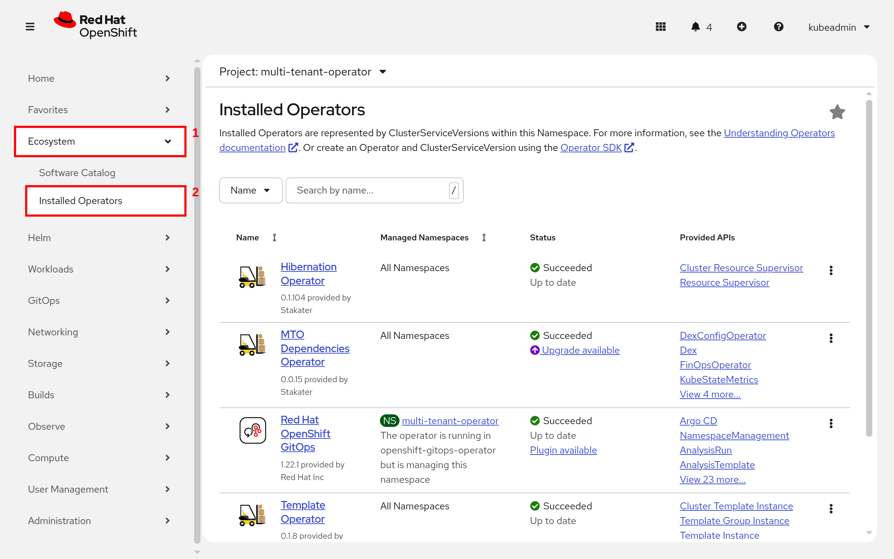

* Now click on uninstall and confirm uninstall.

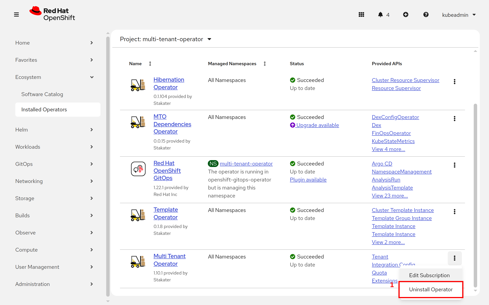

* Now the operator has been uninstalled.

* `Optional:` you can also manually remove MTO's CRDs and its resources from the cluster.

## Notes

* For details on licensing of MTO please refer [Pricing](../../pricing.md).
* For more details on how to use MTO please refer [Tenant tutorial](../../guides/create-tenant.md).
* For details on how to extend your MTO manager ClusterRole please refer [extend-default-clusterroles](../../guides/extend-default-roles.md).
