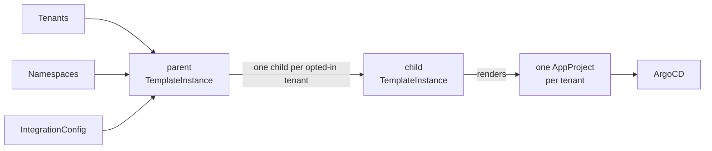

# ArgoCD

Give every tenant its own ArgoCD `AppProject` — scoped to the tenant's namespaces, with owner, edit and view roles — derived from the `Tenant` you already maintain and kept in sync as it changes.

!!! note
    This is the Helm-chart ArgoCD extension ([`mto-extension-argocd`](https://github.com/stakater/mto-extension-argocd)). It replaces the built-in ArgoCD integration configured through the `Extensions` resource, now deprecated — see [the older integration](../argocd.md) and [Migrating](migrating.md).

!!! warning "Requires Template Operator v2"
    The extension is **configuration for [Template Operator v2](https://github.com/stakater/template-operator-v2)** (custom resources in the `templates.v2.stakater.com` API group) — it installs no controller of its own and does nothing until Template Operator v2 reconciles it. Template Operator v2 must be running on the cluster; MTO can deploy it for you. See [Installation](installation.md).

## At a glance

| You maintain | The extension keeps in sync |
|:---|:---|
| a `Tenant` | one `AppProject` per tenant |
| and opt it in (one annotation) | scoped to the tenant's namespaces |
| | owner / edit / view roles, bound to its groups and users |
| | the repositories it may deploy from |
| | the cluster-scoped kinds it may manage |

**You write** — a `Tenant`, opted in:

```yaml
apiVersion: tenantoperator.stakater.com/v1beta3
kind: Tenant
metadata:
  name: acme
  annotations:
    argocd.tenantoperator.stakater.com/enabled: "true"   # opt in
spec:
  accessControl:
    owners:
      groups: [acme-admins]
      users:  [alice@acme.example]
  namespaces:
    withTenantPrefix: [dev, prod]
```

**You get** — one `AppProject`, kept in sync (abridged):

```yaml
apiVersion: argoproj.io/v1alpha1
kind: AppProject
metadata:
  name: acme
  namespace: openshift-gitops
spec:
  destinations:                       # the tenant's namespaces — never the control plane
    - { namespace: acme-dev,  server: https://kubernetes.default.svc }
    - { namespace: acme-prod, server: https://kubernetes.default.svc }
  roles:                              # bound to the tenant's groups and users
    - { name: acme-owner, ... }       # full access to acme/*
    - { name: acme-edit,  ... }       # get, sync, update
    - { name: acme-view,  ... }       # get
  sourceRepos: [ https://github.com/acme/acme-gitops ]
```

No `AppProject` YAML and no hand-written ArgoCD RBAC — and nothing is created for a tenant until it opts in.

## How it works

The chart installs no operator of its own. It renders three [Template Operator v2](https://github.com/stakater/template-operator-v2) objects — a parent `Template`, a child `Template`, and one parent `TemplateInstance` — and Template Operator v2 reconciles one `AppProject` per tenant.



The parent reads every `Tenant`, every `Namespace`, and the `IntegrationConfig` — three cluster-wide watches regardless of tenant count — and emits one child per opted-in tenant. A namespace event affecting one tenant rewrites only that tenant's project.

## Who does what

| | Platform administrator | Tenant |
|:---|:---|:---|
| **Sets up** | installs the chart; sets `argocd.namespace`, repos, resource limits | — |
| **Per tenant** | nothing — opt-in is one annotation | opts in; creates Applications in its project |
| **Never** | hand-writes an `AppProject` or ArgoCD RBAC | touches ArgoCD RBAC, or reaches another tenant's project |

The division is the point: a tenant gets self-service GitOps scoped to itself, and the platform team maintains no per-tenant ArgoCD configuration.

## How roles map to ArgoCD access

Each `Tenant` access level becomes one `AppProject` role, at least privilege by default (`roles.profile: leastPrivilege`):

| Tenant level | ArgoCD role | `applications` | `applicationsets` | repositories / clusters / logs |
|:---|:---|:---|:---|:---|
| owners | `<tenant>-owner` | full (`*`) | full (`*`) | `get` (repos `*`) |
| editors | `<tenant>-edit` | `get`, `sync`, `update`, `action/*` | `get` | `get` |
| viewers | `<tenant>-view` | `get` | `get` | `get` |

Edit cannot create, delete or override Applications, and the web terminal (`exec`) is off unless you enable it for owners. The legacy, broader shape exists for migration only — see [Security](security.md) and [Migrating](migrating.md).

!!! info "Built on Template Operator"
    Because the extension renders through Template Operator, the permissions the chart grants are shared with anyone who can author a `Template`. On a cluster where tenants (or others) can create Templates, read [Security → Template authors share these permissions](security.md#template-authors-share-these-permissions) before going to production.

## In this section

1. [Installation](installation.md) — requirements, install the chart, opt a tenant in
1. [Giving a tenant an AppProject](giving-a-tenant-an-appproject.md) — opt in, see the `AppProject`, deploy an Application
1. [Applications in tenant namespaces](applications.md) — Applications and ApplicationSets outside the control plane
1. [Identity and sync impersonation](identity-and-impersonation.md) — groups by pattern, syncing as a tenant ServiceAccount
1. [Security](security.md) — least-privilege defaults, cluster-scoped kinds, the trust boundary
1. [Operating](operating.md) — drift protection, deletion, fleet health, uninstall
1. [Reference](reference.md) — chart values and per-tenant overrides
1. [Migrating](migrating.md) — from the deprecated `Extensions` integration

---

**Next:** [Installation](installation.md)
