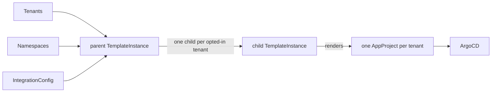

# ArgoCD

!!! note
    This is the Helm-chart ArgoCD extension ([`mto-extension-argocd`](https://github.com/stakater/mto-extension-argocd)). It replaces the built-in ArgoCD integration configured through the `Extensions` resource, which is now deprecated — see [the older integration](../argocd.md) and [Migrating](migrating.md).

With the Multi-Tenant Operator (MTO), a cluster administrator gives every tenant its own ArgoCD `AppProject`, scoped to that tenant's namespaces, with owner, edit and view roles — derived from the `Tenant` you already maintain, and kept in step as the tenant changes.

The extension is a Helm chart. It installs no operator and no controller of its own: it renders a few [Template Operator](../build-your-own/template-operator-essentials.md) objects, and Template Operator reconciles one `AppProject` per tenant. Nothing is created for a tenant until that tenant opts in.

## What it saves you

Setting a tenant up in ArgoCD by hand means creating, per tenant: an `AppProject` scoped to the right namespaces, a role for each access level, the policies behind each role, and the source-repository and resource allow/deny lists. All of it has to be revisited whenever the tenant gains a namespace, changes membership, or adjusts what it may deploy.

The extension derives all of it from the `Tenant` resource and keeps it current — creating what is now needed and removing what no longer applies. A tenant member never hand-edits ArgoCD RBAC.

## What each tenant gets

Opt a `Tenant` in, and one `AppProject` appears in the ArgoCD namespace:

- **Destinations** are the tenant's own namespaces — never the ArgoCD control-plane namespace (see [Security](security.md)).
- **Three roles** — owner, edit, view — bound to the tenant's groups and users, each at least privilege (see [How roles map to ArgoCD access](#how-roles-map-to-argocd-access)).
- **Source repositories** the tenant may deploy from, from a per-tenant pattern.
- **Allowed cluster-scoped kinds** and **denied namespaced kinds**, as the platform sets them.

Remove the opt-in and the extension stops managing the `AppProject`; whether it is kept or deleted is covered in [Operating](operating.md#what-deletes-an-appproject).

## How roles map to ArgoCD access

Each `Tenant` access level becomes one `AppProject` role, at least privilege by default (`roles.profile: leastPrivilege`):

| Tenant level | ArgoCD role | `applications` | `applicationsets` | repositories / clusters / logs |
|:---|:---|:---|:---|:---|
| owners | `<tenant>-owner` | full (`*`) | full (`*`) | `get` (repos `*`) |
| editors | `<tenant>-edit` | `get`, `sync`, `update`, `action/*` | `get` | `get` |
| viewers | `<tenant>-view` | `get` | `get` | `get` |

Edit cannot create, delete or override Applications, and the web terminal (`exec`) is off unless you turn it on for owners. The legacy, broader shape is available for migration only — see [Security](security.md) and [Migrating](migrating.md).

## How it works

The chart installs a parent `Template`, a child `Template`, and the one parent `TemplateInstance`. The parent reads every `Tenant`, every `Namespace`, and the `IntegrationConfig` — three cluster-wide watches regardless of tenant count — and emits one child per opted-in tenant; each child renders that tenant's `AppProject`. A namespace event affecting one tenant rewrites only that tenant's project.

Because the extension is built on Template Operator, the same cluster-wide note applies as for any extension: the permissions the chart grants are shared with anyone who can author a `Template`. See [Security](security.md#template-authors-share-these-permissions).

## In this section

1. [Installation](installation.md) — requirements, install the chart, opt a tenant in
1. [Giving a tenant a project](giving-a-tenant-a-project.md) — opt in, see the `AppProject`, create an Application
1. [Applications in tenant namespaces](applications.md) — Applications and ApplicationSets outside the control plane
1. [Identity and sync impersonation](identity-and-impersonation.md) — groups by pattern, syncing as a tenant ServiceAccount
1. [Security](security.md) — least-privilege defaults, cluster-scoped kinds, the trust boundary
1. [Operating](operating.md) — drift protection, deletion, fleet health, uninstall
1. [Reference](reference.md) — chart values and per-tenant overrides
1. [Migrating](migrating.md) — from the deprecated `Extensions` integration
