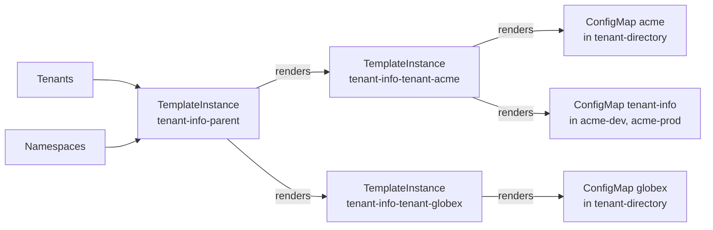

# Tutorial: your first extension

This tutorial builds a complete extension, `tenant-info`, and runs it on a local cluster. It takes about 30 minutes.

`tenant-info` is deliberately small, but it has the same shape as the ArgoCD and Vault extensions Stakater ships:

- A tenant opts in with an annotation.
- For every tenant that opts in, the extension writes a directory entry, a `ConfigMap` named after the tenant, into one shared namespace. The ArgoCD extension writes an `AppProject` into the ArgoCD namespace in the same way.
- It also writes a `tenant-info` `ConfigMap` into each of the tenant's own namespaces, so workloads can discover which tenant they belong to and who owns it.
- A tenant can add its own labels through a second annotation, and a malformed value breaks only that tenant.
- Everything follows the `Tenant`: add a namespace, change an owner or opt out, and the ConfigMaps follow.

Read [Build your own extension](overview.md) first if you have not, and keep [Template Operator essentials](template-operator-essentials.md) open as a reference.

## Before you start

You need Docker, [kind](https://kind.sigs.k8s.io/) 0.30 or later, `kubectl` and Helm 3.

Every file in this tutorial goes into a directory called `tenant-info/`, and every command runs from its parent directory.

## Step 1: create a cluster

template-operator-v2's CRDs need Kubernetes 1.33 or later; they do not install on 1.31.

```bash
cat > kind.yaml <<'EOF'
kind: Cluster
apiVersion: kind.x-k8s.io/v1alpha4
nodes:
  - role: control-plane
    image: kindest/node:v1.33.4
EOF
kind create cluster --name mto-ext --config kind.yaml
```

Install cert-manager. Both MTO and template-operator-v2 issue their webhook certificates through it.

```bash
kubectl apply -f https://github.com/cert-manager/cert-manager/releases/download/v1.20.0/cert-manager.yaml
kubectl -n cert-manager wait deploy --all --for=condition=Available --timeout=300s
```

## Step 2: install MTO and template-operator-v2

Install MTO from its public chart. MTO refuses to create a namespace that does not belong to a tenant, unless the request comes from one of its bypassed groups. On a kind cluster, the admin user is in `kubeadm:cluster-admins`, so add that group:

```bash
cat > mto-values.yaml <<'EOF'
webhook:
  manager:
    env:
      bypassedGroups: system:masters,kubeadm:cluster-admins
EOF
helm install tenant-operator oci://ghcr.io/stakater/public/charts/tenant-operator \
  --namespace multi-tenant-operator --create-namespace \
  --values mto-values.yaml --wait --timeout 10m
```

MTO deploys template-operator-v2 for you when the IntegrationConfig asks for it. template-operator-v2 is the only component of an extension that runs code; the extension you are about to write is configuration for it.

```bash
kubectl -n multi-tenant-operator wait integrationconfigs.tenantoperator.stakater.com/tenant-operator-config \
  --for=create --timeout=120s
kubectl -n multi-tenant-operator patch integrationconfigs.tenantoperator.stakater.com tenant-operator-config \
  --type merge -p '{"spec":{"components":{"templateOperatorV2":{"mode":"Managed"}}}}'
kubectl -n multi-tenant-operator wait deployment/template-operator-v2-controller-manager --for=create --timeout=180s
kubectl -n multi-tenant-operator wait deployment/template-operator-v2-controller-manager --for=condition=Available --timeout=300s
```

Your extension grants permissions to template-operator-v2's ServiceAccount, so note its name:

```bash
kubectl -n multi-tenant-operator get deployment template-operator-v2-controller-manager \
  -o jsonpath='{.spec.template.spec.serviceAccountName}{"\n"}'
```

```text
tenant-operator-template-operator-v2
```

If you install template-operator-v2 yourself instead of through MTO, see [Installing template-operator-v2](template-operator-essentials.md#installing-template-operator-v2). The ServiceAccount then has a different name and namespace.

## Step 3: create two tenants

The extension needs tenants to work on. Create a quota and two tenants, each with two namespaces. Without a licence, MTO allows two tenants per cluster, which is all this tutorial needs. MTO creates the namespaces and labels each one `stakater.com/tenant: <tenant>`, which is what the extension keys on.

```bash
kubectl apply -f - <<'EOF'
apiVersion: tenantoperator.stakater.com/v1beta1
kind: Quota
metadata:
  name: small
spec:
  resourcequota:
    hard:
      configmaps: "10"
---
apiVersion: tenantoperator.stakater.com/v1beta3
kind: Tenant
metadata:
  name: acme
spec:
  quota: small
  accessControl:
    owners:
      groups: [acme-admins]
      users: [alice@acme.example]
  namespaces:
    withTenantPrefix: [dev, prod]
---
apiVersion: tenantoperator.stakater.com/v1beta3
kind: Tenant
metadata:
  name: globex
spec:
  quota: small
  accessControl:
    owners:
      users: [bob@globex.example]
  namespaces:
    withTenantPrefix: [dev, prod]
EOF
kubectl create namespace tenant-directory
```

MTO creates the namespaces within a few seconds. Wait for the last one, then check that each is labelled:

```bash
kubectl wait namespace/globex-prod --for=create --timeout=60s
kubectl get namespaces -l stakater.com/tenant -L stakater.com/tenant
```

```text
NAME          STATUS   AGE   TENANT
acme-dev      Active   10s   acme
acme-prod     Active   10s   acme
globex-dev    Active   10s   globex
globex-prod   Active   10s   globex
```

## Step 4: write the chart

An extension is a Helm chart. Helm only installs it; on the cluster, template-operator-v2 does all the work.

```text
tenant-info/
├── Chart.yaml
├── values.yaml
├── files/
│   ├── parent.tpl                      the parent's gotemplate
│   └── child.tpl                       the child's gotemplate
└── templates/
    ├── _helpers.tpl
    ├── 00-rbac.yaml                    what template-operator-v2 may read and write
    ├── 10-child-template.yaml          renders one tenant
    ├── 20-parent-template.yaml         emits one child per tenant
    └── 30-parent-templateinstance.yaml the only instance you install
```

The gotemplate files live under `files/`, not inline in the Template manifests. Helm and template-operator-v2 both use `{{ }}`. Under `templates/`, Helm would try to render template-operator-v2's actions at install time. Helm never renders `files/`, so the chart reads them verbatim with `.Files.Get`.

### Chart metadata and values

Create `tenant-info/Chart.yaml`:

```yaml
apiVersion: v2
name: tenant-info
description: Example MTO extension. Publishes each opted-in tenant's namespaces and owners as ConfigMaps.
type: application
version: 0.1.0
appVersion: "0.1.0"
```

Create `tenant-info/values.yaml`:

```yaml
# Namespace that holds this extension's Templates and TemplateInstances.
operatorNamespace: multi-tenant-operator

# Namespace that receives one directory ConfigMap per tenant. Must exist.
directoryNamespace: tenant-directory

# Label MTO puts on every tenant namespace. Its value is the tenant name.
tenantNamespaceLabel: stakater.com/tenant

# A tenant opts in with this annotation set to exactly "true".
optInAnnotation: tenant-info.example.com/enabled

# A tenant may add labels to its tenant-info ConfigMaps with this annotation,
# as a JSON object: '{"team":"payments"}'.
labelsAnnotation: tenant-info.example.com/labels

# The ServiceAccount template-operator-v2 runs as. The RBAC below binds to it.
# These are the names when MTO manages template-operator-v2.
templateOperator:
  serviceAccount: tenant-operator-template-operator-v2
  namespace: multi-tenant-operator
```

Create `tenant-info/templates/_helpers.tpl`:

```yaml
{{- define "tenant-info.labels" -}}
app.kubernetes.io/name: {{ .Chart.Name }}
app.kubernetes.io/instance: {{ .Release.Name }}
app.kubernetes.io/managed-by: {{ .Release.Service }}
{{- end -}}

{{- /* Kept when the release is uninstalled: template-operator-v2 still needs
       these grants to delete what it rendered. Remove them after teardown. */ -}}
{{- define "tenant-info.keep" -}}
helm.sh/resource-policy: keep
{{- end -}}
```

### RBAC

Out of the box, template-operator-v2 may manage Templates and TemplateInstances and read Namespaces, and nothing else. Your extension grants it everything else it reads or writes.

Two rules decide what goes in here:

- **List and watch every kind you render, cluster-wide.** When a TemplateInstance is deleted, template-operator-v2 finds what it owns by listing each rendered kind across the whole cluster. A namespaced Role is not enough: the delete fails with `forbidden`, and the TemplateInstance stays in `Terminating`.
- **Keep the RBAC when the chart is uninstalled.** template-operator-v2 needs these grants to clean up. If Helm deleted them along with the Templates, teardown would deadlock. `helm.sh/resource-policy: keep` stops that, and you delete them yourself at the end.

Create `tenant-info/templates/00-rbac.yaml`:

```yaml
{{- $sa := .Values.templateOperator }}
# Read the parent's inputs, cluster-wide.
apiVersion: rbac.authorization.k8s.io/v1
kind: ClusterRole
metadata:
  name: tenant-info-read
  labels: {{- include "tenant-info.labels" . | nindent 4 }}
  annotations: {{- include "tenant-info.keep" . | nindent 4 }}
rules:
  - apiGroups: ["tenantoperator.stakater.com"]
    resources: ["tenants"]
    verbs: ["get", "list", "watch"]
  - apiGroups: [""]
    resources: ["namespaces"]
    verbs: ["get", "list", "watch"]
---
# Write the ConfigMaps the children render. Tenant namespaces come and go, so
# this one is cluster-wide.
apiVersion: rbac.authorization.k8s.io/v1
kind: ClusterRole
metadata:
  name: tenant-info-write
  labels: {{- include "tenant-info.labels" . | nindent 4 }}
  annotations: {{- include "tenant-info.keep" . | nindent 4 }}
rules:
  - apiGroups: [""]
    resources: ["configmaps"]
    verbs: ["get", "list", "watch", "create", "update", "patch", "delete"]
---
apiVersion: rbac.authorization.k8s.io/v1
kind: ClusterRoleBinding
metadata:
  name: tenant-info-read
  labels: {{- include "tenant-info.labels" . | nindent 4 }}
  annotations: {{- include "tenant-info.keep" . | nindent 4 }}
roleRef:
  apiGroup: rbac.authorization.k8s.io
  kind: ClusterRole
  name: tenant-info-read
subjects:
  - kind: ServiceAccount
    name: {{ $sa.serviceAccount }}
    namespace: {{ $sa.namespace }}
---
apiVersion: rbac.authorization.k8s.io/v1
kind: ClusterRoleBinding
metadata:
  name: tenant-info-write
  labels: {{- include "tenant-info.labels" . | nindent 4 }}
  annotations: {{- include "tenant-info.keep" . | nindent 4 }}
roleRef:
  apiGroup: rbac.authorization.k8s.io
  kind: ClusterRole
  name: tenant-info-write
subjects:
  - kind: ServiceAccount
    name: {{ $sa.serviceAccount }}
    namespace: {{ $sa.namespace }}
```

### The child: one tenant

The child Template renders everything for one tenant. It knows nothing about the cluster; the parent hands it every fact it needs as a parameter.

Create `tenant-info/templates/10-child-template.yaml`:

```yaml
apiVersion: templates.v2.stakater.com/v2alpha1
kind: Template
metadata:
  name: tenant-info-child
  namespace: {{ .Values.operatorNamespace }}
  labels: {{- include "tenant-info.labels" . | nindent 4 }}
spec:
  parameters:
    - name: tenant
      required: true
      exposeInStatus: true
    # Lists travel JSON-encoded: an empty list must not become "".
    - name: namespacesJson
      value: "[]"
    - name: ownersJson
      value: "[]"
    - name: labelsJson
      value: "{}"
    - name: directoryNamespace
      value: {{ .Values.directoryNamespace | quote }}
  sync:
    mode: strict
    # template-operator-v2 updates its own finalizer on every rendered object.
    ignoreFields: [metadata.finalizers]
  gotemplate: |
    {{- .Files.Get "files/child.tpl" | nindent 4 }}
  outputs:
    - name: directory
      from:
        apiVersion: v1
        kind: ConfigMap
        name: "{.parameters.tenant}"
        namespace: "{.parameters.directoryNamespace}"
      fields:
        - name: namespaces
          jsonPath: "{.data.namespaces}"
```

Three choices here are worth knowing about:

- **Lists are passed as JSON strings.** A TemplateInstance parameter value is a string. Join a list with commas and an empty list becomes `""`, which template-operator-v2 treats as an unset parameter and rejects. A tenant with no namespaces is common, so encode lists as JSON (`"[]"`) and decode them in the gotemplate.
- **`sync: strict` protects what you render.** template-operator-v2 reverts edits to rendered objects, and an admission webhook refuses edits and deletes outright. Without the webhook (`revert`), a hand-deleted object is left stuck in `Terminating` while the TemplateInstance still reports `Ready`. `metadata.finalizers` must be exempt, or template-operator-v2 locks itself out of its own finalizer.
- **`outputs` surfaces a result in the TemplateInstance status**, so you can check the tenant without reading the ConfigMap.

Create `tenant-info/files/child.tpl`:

```yaml
{{- /* Renders ONE tenant. Executed by template-operator-v2, not Helm. */ -}}
{{- $tenant := .parameters.tenant }}
{{- $namespaces := mustFromJson .parameters.namespacesJson }}
{{- $owners := mustFromJson .parameters.ownersJson }}
{{- $labels := mustFromJson .parameters.labelsJson }}
{{- if not (kindIs "map" $labels) }}
{{- fail (printf "the labels annotation must be a JSON object, got %s" (kindOf $labels)) }}
{{- end }}
{{- range $k, $v := $labels }}
{{- if not (kindIs "string" $v) }}
{{- fail (printf "label %q must have a string value, got %s" $k (kindOf $v)) }}
{{- end }}
{{- end }}
apiVersion: v1
kind: ConfigMap
metadata:
  name: {{ $tenant | quote }}
  namespace: {{ .parameters.directoryNamespace | quote }}
data:
  tenant: {{ $tenant | quote }}
  namespaces: {{ join "," $namespaces | quote }}
  owners: {{ join "," $owners | quote }}
{{- range $ns := $namespaces }}
---
apiVersion: v1
kind: ConfigMap
metadata:
  name: tenant-info
  namespace: {{ $ns | quote }}
  {{- with $labels }}
  labels:
    {{- range $k, $v := . }}
    {{ $k | quote }}: {{ $v | quote }}
    {{- end }}
  {{- end }}
data:
  tenant: {{ $tenant | quote }}
  owners: {{ join "," $owners | quote }}
{{- end }}
```

Decoding uses `mustFromJson`, which fails on malformed input. The plain `fromJson` hides the error and renders garbage into a live object. The checks after it reject values that are valid JSON but the wrong shape: a list where an object belongs, or a number where a label needs a string. Each failure stops this one tenant's render and names the problem.

### The parent: every tenant

The parent Template reads the cluster and fans out. Each render emits one child TemplateInstance per opted-in tenant, with that tenant's facts as parameters.

Create `tenant-info/templates/20-parent-template.yaml`:

```yaml
apiVersion: templates.v2.stakater.com/v2alpha1
kind: Template
metadata:
  name: tenant-info-parent
  namespace: {{ .Values.operatorNamespace }}
  labels: {{- include "tenant-info.labels" . | nindent 4 }}
spec:
  parameters:
    # Supplied by the parent TemplateInstance from the cluster.
    - name: tenants
      required: true
    - name: namespaces
      required: true
    # Chart values, baked in at install time.
    - name: operatorNamespace
      value: {{ .Values.operatorNamespace | quote }}
    - name: tenantNamespaceLabel
      value: {{ .Values.tenantNamespaceLabel | quote }}
    - name: optInAnnotation
      value: {{ .Values.optInAnnotation | quote }}
    - name: labelsAnnotation
      value: {{ .Values.labelsAnnotation | quote }}
  sync:
    mode: strict
    ignoreFields: [metadata.finalizers]
  gotemplate: |
    {{- .Files.Get "files/parent.tpl" | nindent 4 }}
  outputs:
    # One place to answer "is every tenant reconciled?"
    - name: tenants
      fromAll:
        apiVersion: templates.v2.stakater.com/v2alpha1
        kind: TemplateInstance
        namespace: {{ .Values.operatorNamespace }}
      keyTemplate: "{.metadata.name}"
      fields:
        - name: ready
          jsonPath: "{.status.conditions[?(@.type=='Ready')].status}"
        - name: errors
          jsonPath: "{.status.conditions[?(@.status=='False')].message}"
```

The `errors` field selects every condition whose status is `False`. Template-operator-v2's `Ready` condition only ever summarises ("Template rendering failed"), and the cause sits on the condition that failed. This field collects the real message, whichever stage broke, and stays empty while the tenant is healthy.

Create `tenant-info/files/parent.tpl`:

```yaml
{{- /* Ranges over every Tenant and emits one child TemplateInstance per
       opted-in tenant. Executed by template-operator-v2, not Helm. */ -}}
{{- $opNs := .parameters.operatorNamespace }}
{{- $nsLabel := .parameters.tenantNamespaceLabel }}
{{- $optIn := .parameters.optInAnnotation }}
{{- $labelsKey := .parameters.labelsAnnotation }}

{{- /* Pass 1: which tenants opted in. Optional keys are read with `index`,
       never as fields: a missing key must not fail the whole parent. */ -}}
{{- $optedIn := dict }}
{{- range $t := .parameters.tenants }}
{{- $annotations := default dict (index $t.metadata "annotations") }}
{{- if eq (index $annotations $optIn | default "") "true" }}
{{- $_ := set $optedIn $t.metadata.name true }}
{{- end }}
{{- end }}

{{- /* Pass 2: bucket namespaces by tenant, in one pass over the list. */ -}}
{{- $byTenant := dict }}
{{- range $ns := .parameters.namespaces }}
{{- $labels := default dict (index $ns.metadata "labels") }}
{{- $owner := index $labels $nsLabel | default "" }}
{{- if hasKey $optedIn $owner }}
{{- $_ := set $byTenant $owner (append (get $byTenant $owner | default list) $ns.metadata.name) }}
{{- end }}
{{- end }}

{{- /* Pass 3: one child per opted-in tenant. */ -}}
{{- range $t := .parameters.tenants }}
{{- $name := $t.metadata.name }}
{{- if hasKey $optedIn $name }}
{{- $spec := default dict (index $t "spec") }}
{{- $ac := default dict (index $spec "accessControl") }}
{{- $ownersBlock := default dict (index $ac "owners") }}
{{- /* Passed down verbatim and parsed in the child, so a malformed value
       fails that one tenant, not the parent. */ -}}
{{- $annotations := default dict (index $t.metadata "annotations") }}
{{- $labelsJson := "{}" }}
{{- if hasKey $annotations $labelsKey }}{{- $labelsJson = index $annotations $labelsKey }}{{- end }}
{{- $owners := concat (default list (index $ownersBlock "groups")) (default list (index $ownersBlock "users")) }}
---
apiVersion: templates.v2.stakater.com/v2alpha1
kind: TemplateInstance
metadata:
  name: tenant-info-tenant-{{ $name }}
  namespace: {{ $opNs }}
spec:
  templateRef:
    name: tenant-info-child
    namespace: {{ $opNs }}
  parameters:
    - name: tenant
      value: {{ $name | quote }}
    - name: namespacesJson
      value: {{ get $byTenant $name | default list | toJson | quote }}
    - name: ownersJson
      value: {{ $owners | toJson | quote }}
    - name: labelsJson
      value: {{ $labelsJson | quote }}
{{- end }}
{{- end }}
```

The parent's main rule: **never fail for one tenant's sake.** Every tenant goes through this one render, so an error here stops every tenant at once. That is why:

- Optional keys are read with `index`, never as fields. From 0.0.8, template-operator-v2 renders with `missingkey=error`, so `$t.metadata.annotations` on a Tenant that has no annotations fails the render. `index` returns nothing for a missing key, and `default dict` turns that into an empty map.
- The labels annotation is not parsed here. It goes to the child verbatim, so a malformed value fails only that tenant's child.
- Namespaces are grouped in a single pass over the list. A loop over namespaces inside the loop over tenants costs tenants × namespaces steps, on every Namespace event in the cluster.
- Children are named `tenant-info-tenant-<name>`. Without the `tenant-` segment, a Tenant called `parent` would give a child named `tenant-info-parent`, which is the parent itself.

### The parent TemplateInstance

This is the only TemplateInstance you install. Its parameters read the cluster: an `objectFieldRef` without a `name` lists every object of that kind and watches them, so the parent re-renders whenever a Tenant or a Namespace changes.

Create `tenant-info/templates/30-parent-templateinstance.yaml`:

```yaml
# The only TemplateInstance you install. The children are rendered by it.
apiVersion: templates.v2.stakater.com/v2alpha1
kind: TemplateInstance
metadata:
  name: tenant-info-parent
  namespace: {{ .Values.operatorNamespace }}
  labels: {{- include "tenant-info.labels" . | nindent 4 }}
spec:
  templateRef:
    name: tenant-info-parent
    namespace: {{ .Values.operatorNamespace }}
  parameters:
    # No name: template-operator-v2 LISTs every Tenant and watches them.
    - name: tenants
      valueFrom:
        objectFieldRef:
          apiVersion: tenantoperator.stakater.com/v1beta3
          kind: Tenant
          jsonPath: .items
    - name: namespaces
      valueFrom:
        objectFieldRef:
          apiVersion: v1
          kind: Namespace
          jsonPath: .items
```

## Step 5: install it

Lint, then install into the namespace that holds the Templates:

```bash
helm lint tenant-info
helm install tenant-info ./tenant-info --namespace multi-tenant-operator
kubectl -n multi-tenant-operator wait templateinstances.templates.v2.stakater.com/tenant-info-parent \
  --for=jsonpath='{.status.phase}'=Ready --timeout=60s
```

Always use the full resource name, `templateinstances.templates.v2.stakater.com`. On OpenShift, the short name `templateinstance` means OpenShift's own `template.openshift.io` kind.

No tenant has opted in yet, so the parent renders no children:

```bash
kubectl -n multi-tenant-operator get templateinstances.templates.v2.stakater.com
```

```text
NAME                 AGE
tenant-info-parent   5s
```

## Step 6: opt a tenant in

```bash
kubectl annotate tenant acme tenant-info.example.com/enabled=true
kubectl -n multi-tenant-operator wait templateinstances.templates.v2.stakater.com/tenant-info-tenant-acme \
  --for=create --timeout=60s
kubectl -n multi-tenant-operator wait templateinstances.templates.v2.stakater.com/tenant-info-tenant-acme \
  --for=jsonpath='{.status.phase}'=Ready --timeout=60s
```

The value must be exactly `"true"`. The parent compares strings, so `True`, `yes` and `1` all leave the tenant out.

The directory entry:

```bash
kubectl -n tenant-directory get configmap acme -o jsonpath='{.data}'
```

```text
{"namespaces":"acme-dev,acme-prod","owners":"acme-admins,alice@acme.example","tenant":"acme"}
```

And the ConfigMap in each of the tenant's namespaces:

```bash
kubectl -n acme-dev get configmap tenant-info -o jsonpath='{.data}'
```

```text
{"owners":"acme-admins,alice@acme.example","tenant":"acme"}
```

`globex` did not opt in, so it has nothing:

```bash
kubectl -n globex-dev get configmap tenant-info
```

```text
Error from server (NotFound): configmaps "tenant-info" not found
```

The child's status tells you what it rendered and what the output read back:

```bash
kubectl -n multi-tenant-operator get templateinstances.templates.v2.stakater.com tenant-info-tenant-acme \
  -o jsonpath='{.status.outputs}{"\n"}{range .status.renderedResources[*]}{.kind}/{.name} in {.namespace}{"\n"}{end}'
```

```text
{"namespaces":{"acme":"acme-dev,acme-prod"}}
ConfigMap/acme in tenant-directory
ConfigMap/tenant-info in acme-dev
ConfigMap/tenant-info in acme-prod
```

## Step 7: watch it follow the tenant

Add a namespace to `acme`:

```bash
kubectl patch tenant acme --type merge -p '{"spec":{"namespaces":{"withTenantPrefix":["dev","prod","qa"]}}}'
kubectl -n acme-qa wait configmap/tenant-info --for=create --timeout=60s
kubectl -n tenant-directory get configmap acme -o jsonpath='{.data.namespaces}{"\n"}'
```

```text
acme-dev,acme-prod,acme-qa
```

MTO created `acme-qa` and labelled it. The parent watches Namespaces, so it re-rendered, and the child for `acme` got a new `namespacesJson`.

Now try to change a rendered object by hand:

```bash
kubectl -n acme-dev patch configmap tenant-info --type merge -p '{"data":{"owners":"mallory"}}'
```

```text
Error from server (Forbidden): admission webhook "sync-enforcement.templates.v2.stakater.com" denied the request: resource is managed by sync-enabled TemplateInstance multi-tenant-operator/tenant-info-tenant-acme; modifications to enforced fields are not allowed
```

That is `sync: strict`. The `Tenant` is the only place to change what the extension produces.

## Step 8: per-tenant settings, and what happens when one is wrong

Give `acme` a label through the second annotation:

```bash
kubectl annotate tenant acme 'tenant-info.example.com/labels={"team":"payments"}'
kubectl -n acme-dev wait configmap/tenant-info --for=jsonpath='{.metadata.labels.team}'=payments --timeout=60s
```

Now opt `globex` in with a broken value:

```bash
kubectl annotate tenant globex tenant-info.example.com/enabled=true 'tenant-info.example.com/labels={"team":'
kubectl -n multi-tenant-operator wait templateinstances.templates.v2.stakater.com/tenant-info-tenant-globex \
  --for=create --timeout=60s
kubectl -n multi-tenant-operator wait templateinstances.templates.v2.stakater.com/tenant-info-tenant-globex \
  --for=jsonpath='{.status.phase}'=Failed --timeout=60s
kubectl -n multi-tenant-operator get templateinstances.templates.v2.stakater.com \
  -o custom-columns='NAME:.metadata.name,PHASE:.status.phase'
```

```text
NAME                        PHASE
tenant-info-parent          Ready
tenant-info-tenant-acme     Ready
tenant-info-tenant-globex   Failed
```

Only `globex` failed: `acme` is untouched, and so is the parent. The failed child says why:

```bash
kubectl -n multi-tenant-operator get templateinstances.templates.v2.stakater.com tenant-info-tenant-globex \
  -o jsonpath='{.status.conditions[?(@.type=="Rendered")].message}{"\n"}'
```

```text
failed to execute template: template: template:5:15: executing "template" at <mustFromJson .parameters.labelsJson>: error calling mustFromJson: unexpected end of JSON input
```

The parent collects the same message in its outputs the next time it reconciles, usually within seconds. One command then answers "is every tenant healthy, and if not, why?":

```bash
kubectl -n multi-tenant-operator wait templateinstances.templates.v2.stakater.com/tenant-info-parent \
  --for=jsonpath='{.status.outputs.ready.tenant-info-tenant-globex}'='["False"]' --timeout=60s
kubectl -n multi-tenant-operator get templateinstances.templates.v2.stakater.com tenant-info-parent \
  -o jsonpath='{.status.outputs.errors.tenant-info-tenant-globex}{"\n"}'
```

```text
["failed to execute template: template: template:5:15: executing \"template\" at \u003cmustFromJson .parameters.labelsJson\u003e: error calling mustFromJson: unexpected end of JSON input","Template rendering failed"]
```

Fix the value and `globex` recovers:

```bash
kubectl annotate tenant globex --overwrite 'tenant-info.example.com/labels={"team":"research"}'
kubectl -n multi-tenant-operator wait templateinstances.templates.v2.stakater.com/tenant-info-tenant-globex \
  --for=jsonpath='{.status.phase}'=Ready --timeout=60s
```

## Step 9: opt a tenant out

```bash
kubectl annotate tenant globex tenant-info.example.com/enabled-
kubectl -n multi-tenant-operator wait templateinstances.templates.v2.stakater.com/tenant-info-tenant-globex \
  --for=delete --timeout=60s
kubectl -n tenant-directory get configmap globex
```

```text
Error from server (NotFound): configmaps "globex" not found
```

The parent stopped emitting the child, so template-operator-v2 deleted it, and with it everything the child had rendered. Removing objects is part of reconciling: whatever drops out of a render is deleted.

That is usually what you want, but not always. If the objects hold something you cannot recreate, such as data or credentials that people depend on, see [Deletion](design-rules.md#deletion) before you ship.

## Step 10: uninstall in the right order

Order matters. Delete the parent TemplateInstance, wait until every child is gone, and only then uninstall the release. Then remove the RBAC that Helm kept.

```bash
kubectl -n multi-tenant-operator delete templateinstances.templates.v2.stakater.com tenant-info-parent --wait
kubectl -n multi-tenant-operator wait templateinstances.templates.v2.stakater.com \
  -l templates.v2.stakater.com/instance=tenant-info-parent --for=delete --timeout=120s
helm uninstall tenant-info --namespace multi-tenant-operator
kubectl delete clusterrolebinding,clusterrole tenant-info-read tenant-info-write
```

A plain `helm uninstall` deletes the Templates in the same step as the parent TemplateInstance. Without the `keep` annotation it would also delete the RBAC that template-operator-v2 needs to clean up, and every TemplateInstance would stay in `Terminating`.

To delete the cluster:

```bash
kind delete cluster --name mto-ext
```

## What you built



Replace the two ConfigMaps in `child.tpl` with the objects your tool needs, such as an `AppProject` or a `vault-config-operator` `Policy`, and grant the matching RBAC. The rest of the chart stays the same. [Design rules](design-rules.md) covers what changes when the objects matter in production, and [Real extensions](real-extensions.md) shows how ArgoCD and Vault Enterprise do it.
