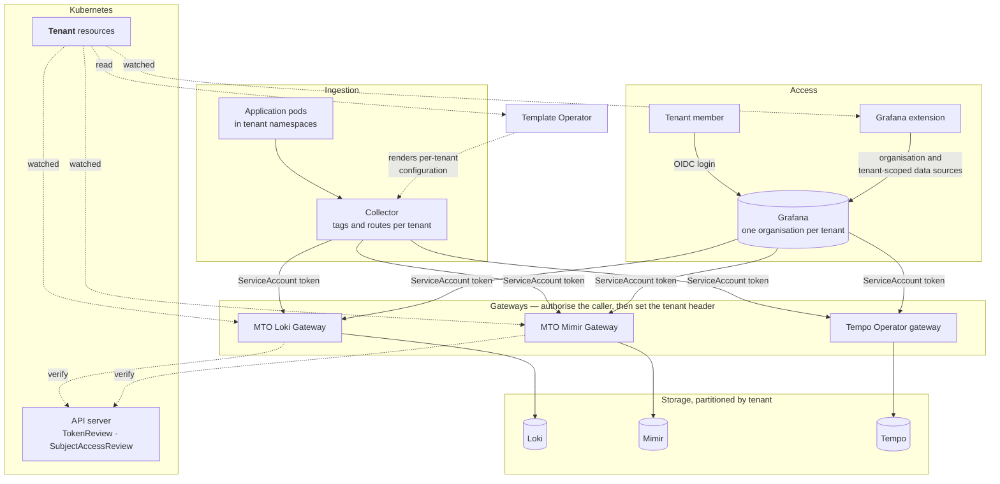

# How it works

Telemetry goes in through a collector and comes back out through Grafana. Both directions cross the same gateways, and the tenant is settled there rather than taken on trust.

## Getting telemetry in

One platform-managed collector serves the whole cluster. It derives each tenant from the namespace its source pod runs in, so workloads need no observability configuration of their own.

An OpenTelemetry Collector is the usual choice, but not the only one — the gateways accept the native protocol of each backend alongside OTLP: Prometheus remote write for metrics, Loki's push API for logs. Whatever writes must do two things: present a ServiceAccount token the gateway authorises, and name the tenant it is writing for.

That second requirement shapes how each one is configured. A collector reads the namespace from each record and routes accordingly, so a single pipeline covers every tenant. Prometheus cannot do that, because remote-write headers are fixed per block — one instance covering many namespaces, such as OpenShift's user workload monitoring, would label every series with the same tenant. It therefore needs a block per tenant, each filtered to that tenant's namespaces.

Neither is written per tenant by hand. The Template Operator that ships with MTO reads your `Tenant` resources and renders the per-tenant configuration — collector routes, remote-write blocks — from that one list, so the repetition is generated from the same source as everything else in this section. It can also be set to reconcile what it rendered, reverting drift.

## What settles the tenant

With multi-tenancy turned on, Loki, Mimir and Tempo each read the tenant from an `X-Scope-OrgID` header, and none of them authenticates it. All three tell you to run an authenticating reverse proxy in front, and to let that proxy set the header. Grafana's boundary is the organisation, and it has no idea which organisation belongs to which tenant. So all four need something alongside them:

| Signal | Component | What settles the tenant | Detail |
|:---|:---|:---|:---|
| Logs | Loki | MTO Loki Gateway | Authorises every request against your tenants, in place of the gateway a `LokiStack` would otherwise run |
| Metrics | Mimir | MTO Mimir Gateway | Authorises every request against your tenants. Mimir has no authenticating layer of its own |
| Traces | Tempo | Tempo Operator gateway | Tempo partitions traces itself; the operator's gateway authenticates and authorises per tenant |
| Dashboards | Grafana | The Grafana extension | Organisations, tenant-scoped data source copies, and access mapped from identity-provider groups |

Both MTO gateways check a caller the same way. The request carries a Kubernetes ServiceAccount token; the gateway verifies it with the TokenReview API, confirms the tenant is one of those it watches, and authorises that caller for that tenant — against an allow-list, or Kubernetes RBAC.

Where they differ is how the tenant is named. A Loki request names it in the URL, as `/api/logs/v1/{tenant}/…`, and the gateway sets the header from that path, discarding whatever header and credentials the caller sent. A Mimir request names it in the header, which the gateway validates and then re-sets from the value it authorised. Either way, a caller reaches only a tenant it was authorised for.

The collector and Grafana are both such callers, each with a ServiceAccount of its own. Going in, the collector names the tenant it routed the telemetry to. Coming out, the tenant comes from the data source the extension wrote for that tenant's organisation — so which tenant a query belongs to is settled by which organisation the person is in.

!!! note
    The MTO gateways use only standard Kubernetes APIs, so they run on any distribution — vanilla Kubernetes, EKS, GKE, AKS or OpenShift.

!!! warning
    Tempo must run behind its gateway, and that gateway's tenants must be kept aligned with yours, because unlike the Loki and Mimir gateways it does not read `Tenant` resources. Tempo on its own accepts whichever tenant a request names, so the gateway is what makes the trace boundary hold.

## What it is made of

Most of the stack is upstream. MTO supplies the pieces that make the tenant boundary real.

| Component | How it can be deployed | Role here |
|:---|:---|:---|
| Loki | The Loki Operator as a `LokiStack`, or its Helm chart | Stores logs, partitioned by tenant |
| Mimir | The `mimir-distributed` Helm chart | Stores metrics, partitioned by tenant |
| Tempo | The Tempo Operator as a `TempoStack`, or the `tempo-distributed` chart | Stores traces, partitioned by tenant, behind its gateway |
| Collector | The OpenTelemetry Operator, its Helm chart or plain manifests | Tags telemetry with its source tenant and writes it through the gateways |
| Grafana | The Grafana Operator | Dashboards and exploration, one organisation per tenant |
| Template Operator | Ships with MTO | Renders per-tenant configuration, such as collector routes and remote-write blocks, from your `Tenant` resources |
| MTO Loki Gateway, MTO Mimir Gateway | Stakater | Verify the caller on every Loki and Mimir request, then set the tenant header |
| The Grafana extension | Stakater | Derives organisations, data sources, dashboards and access from your tenants |

Where both an operator and a chart exist, either will do, and the choice can follow whatever a cluster already runs — on OpenShift that is usually the operator, since Red Hat ships its own Loki, Tempo and OpenTelemetry operators. Three components are narrower than that, for reasons worth knowing rather than working around:

- **Tempo** — both routes deploy Tempo, and both ship a gateway, but the two are not equivalent. The chart's is an nginx proxy offering basic authentication, which identifies a caller without tying it to a tenant. The operator's authenticates with OIDC and authorises per tenant, which is what the trace boundary depends on.
- **Mimir** — Grafana publishes the chart and no operator of its own, so the chart is the route.
- **Grafana** — the extension configures an instance the Grafana Operator owns, so that operator is required rather than preferred.

Stakater can deploy the whole stack, or only the MTO components in front of an LGTM stack you already run. Either way two requirements hold: multi-tenancy must be enabled on Loki, Mimir and Tempo, and whatever collects telemetry must tag it with the source pod's namespace.

---

**Previous:** [Overview](overview.md) · **Next:** [Installation](installation.md)
