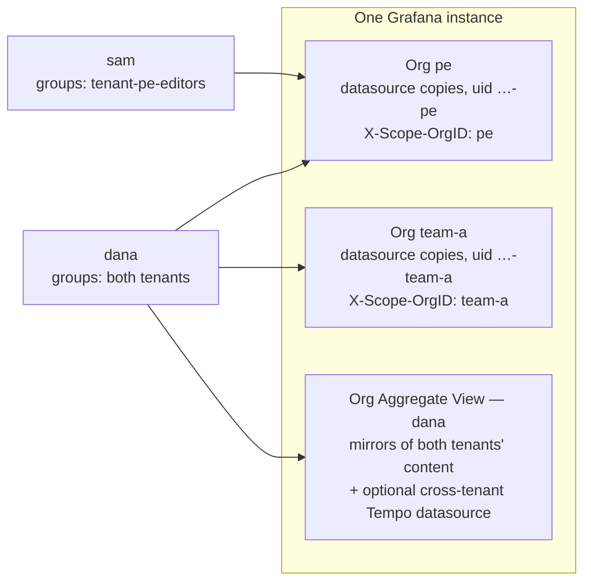
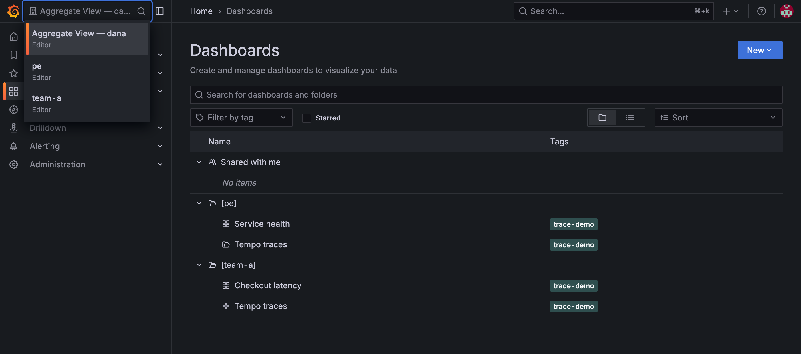
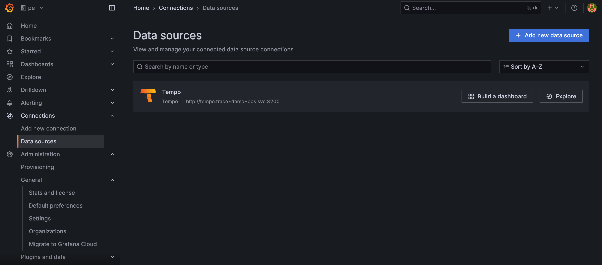
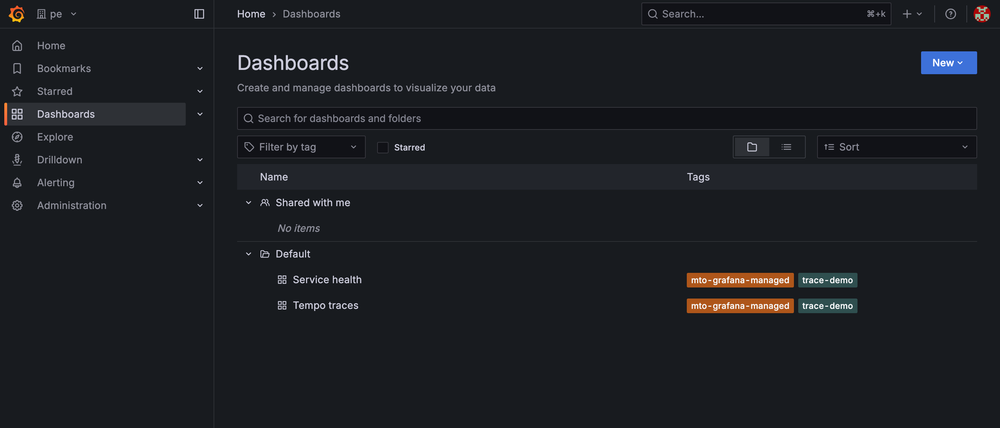

# Overview

Your `Tenant` resources already say who your teams are: which namespaces they own, what they may use, and who may act for them. The Grafana stack integration extends that same definition into observability.

One shared stack — [Loki](https://grafana.com/oss/loki/), [Mimir](https://grafana.com/oss/mimir/), [Tempo](https://grafana.com/oss/tempo/) and [Grafana](https://grafana.com/) — then serves every tenant, and each one reaches only its own logs, metrics, traces and dashboards. Nothing about a tenant is described twice: the `Tenant` that governs its namespaces and access is the tenant the observability stack partitions on.

Note that the Grafana stack integration is optional, and ships as a separate extension.

## What a tenant gets

A tenant member signs in through your identity provider and lands in the Grafana organisation belonging to their tenant. Inside it is that tenant's telemetry and nothing else.

| They get | Detail |
|:---|:---|
| Their own logs, metrics and traces | Every query is answered from that tenant's partition of Loki, Mimir and Tempo, and no other |
| Ad-hoc queries | Explore, LogQL, PromQL and TraceQL, plus live tailing of Loki logs, for members with an editing role |
| Their own alerting rules | The Loki and Mimir rulers, and Mimir's Alertmanager, are served per tenant |
| Their own organisation in Grafana | Named after the tenant, holding dashboards whose panels already point at that tenant's data |
| A role that follows their group | Identity-provider group membership decides which organisations a member sees, and with what role |

Members who belong to several tenants can have more, though none of it is on by default. They can be given one organisation holding every tenant they belong to, rather than switching between them; a data source that follows a single request from one tenant's service into another tenant's; and the option to share a dashboard built there with colleagues whose access covers the same data. All three are configured on the Grafana extension — see [One organisation across a user's tenants](tenant-access-and-roles.md#one-organisation-across-a-users-tenants).

## What you do not have to do

None of that is configured per tenant, and that is the point.

The alternative to one shared stack is one per tenant: multiplied storage, multiplied upgrades, and no way to follow a request across tenants. But a shared stack is only multi-tenant *capable*. Configuring it by hand means keeping a second definition of your tenants in every component that needs one.

| To serve a tenant | By hand | Here |
|:---|:---|:---|
| Say who the tenants are | A list kept in the collector, in each gateway and in Grafana, separately | Read from your `Tenant` resources |
| Per-tenant collector configuration | A route or remote-write block written for each tenant | Rendered from the tenant list by the Template Operator |
| An organisation per tenant | Create each, then keep the set current as tenants change | Derived |
| Data sources | One copy per tenant per signal, each with the right header, and the right URL for Loki | Derived from one definition |
| Dashboards | Import into every organisation, then point every panel at that organisation's own data source | Derived, with references rewritten |
| Who can see what | An org-mapping entry per identity-provider group, per tenant | Derived from the tenant |
| Onboarding | Repeat all of the above | Nothing: it is already a `Tenant` |
| Offboarding | Undo all of the above, everywhere | Its organisation and content go with the `Tenant` |

By hand this multiplies quickly. Ten tenants, three signals and eight shared dashboards comes to ten organisations, thirty data sources, eighty dashboards, thirty org-mapping entries and a routing entry per tenant in the collector — about a hundred and sixty objects to create, and then to keep correct every time a dashboard changes or a tenant arrives. Here it is eleven definitions written once for the cluster: three data sources and eight dashboards. Everything per-tenant is either derived by the operators or rendered from the tenant list by the Template Operator, never authored. The eleventh tenant costs nothing, where by hand it would cost another sixteen.

More valuable than the saving is that two definitions cannot disagree when there is only one. The gateways and the Grafana extension watch `Tenant` resources, and the Template Operator renders from them, so what observability enforces tracks what the cluster grants rather than tracking it at whatever interval someone remembers to reconcile the two. A tenant removed from Kubernetes cannot be left behind with an organisation that still queries its old data — the characteristic failure of a hand-maintained tenant list.

Two properties follow that hand-maintenance struggles to hold:

- **Isolation is structural, not conventional.** Visibility is bounded by Grafana's own organisation boundary, and every data source copy carries its tenant's `X-Scope-OrgID`, so queries through it return that tenant's partition and no other.
- **One stack serves everyone.** An instance per tenant — each with its own upgrades, dashboards, alerting and cost — stops being necessary.

For application teams the work disappears rather than moves. A developer commits one dashboard definition, optionally naming the tenants it is for, and it lands in those organisations with its queries already pointed at the right tenant's data — no organisation switching, no UID edits. Access follows identity too: add someone to a team's group and their Grafana role is waiting at next sign-in.

## What each tenant gets in Grafana

*One instance, one organisation per tenant, one data source copy per organisation. `sam` belongs to a single tenant and can reach only its organisation. `dana` belongs to both, so they also get an aggregated view — holding those two tenants and nothing else.*

| Capability | Default | What it is |
|:---|:---|:---|
| A private organisation | on | A Grafana organisation named exactly after the tenant. Members of one tenant cannot see another tenant's dashboards or data sources. |
| Tenant-scoped data sources | on | One copy of each data source per organisation, with UID `<base-uid>-<tenant>` and `X-Scope-OrgID` set to the tenant name, so a single definition returns only that tenant's data. |
| Dashboards with rewritten queries | on | Each dashboard's data source references — in panels, targets and template variables — are rewritten to that organisation's own data source copy. |
| Folders | on | `GrafanaFolder` titles are replicated into an organisation as dashboards referencing them are synced. A dashboard with no folder lands in a per-organisation folder named `Default`. |
| Human login | on | Tenant members sign in through your OIDC provider, and their identity-provider group membership decides which organisations they see and with what role. |
| Per-tenant targeting | on | Annotations on a data source or dashboard choose which tenants receive it. Without annotations, it goes to every tenant. |
| Aggregated views | off | One extra organisation per user, mirroring the content of every tenant they belong to, so multi-tenant users stop switching organisations. |
| Cross-tenant traces | off | A single union Tempo data source inside the aggregated view, so one distributed trace can be followed across tenants. |
| Shared user dashboards | off | Dashboards a user builds inside their own aggregated view are shared with colleagues whose tenant access covers the same data. |

MTO keeps all of it in step with the cluster:

- an organisation is created when a tenant appears, and deleted when the tenant is removed;
- data source copies are re-asserted on every reconcile, so an edit made in the Grafana UI is undone within one cycle;
- a dashboard or data source is removed from every organisation when its definition is deleted;
- the OAuth org mapping is rewritten whenever the set of tenants changes.

### On a running cluster

Every screenshot in this section comes from one demo instance: two tenants, `pe` and `team-a`, and `dana`, a member of both. The YAML examples elsewhere use `bluesky` and `arsenal` instead.

*`dana` belongs to both tenants, so the switcher offers `pe`, `team-a` and their own aggregated view — and nothing else. They are Editor in both tenants, and Editor in the aggregated view too, that being the lower of the two.*

*Inside `pe`, one data source, still named plainly `Tempo`. The tenant lives in its UID — `tempo-pe` — and in the `X-Scope-OrgID` header, not in anything the team reads on screen.*

*`pe` holds only `pe`'s dashboards; a member here has no route to `team-a`'s. Neither dashboard declared a folder, so both landed in the per-organisation `Default` folder. The `mto-grafana-managed` tag is what cleanup keys on — dashboards made by hand never carry it, so the operator never deletes them.*

---

**Next:** [How it works](how-it-works.md)
