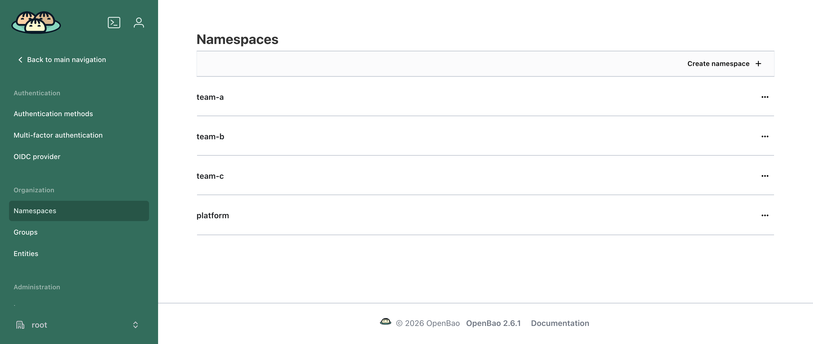

# OpenBao

[OpenBao](https://openbao.org/) is an identity-based secret and encryption management system. With the Multi-Tenant Operator (MTO), the OpenBao extension gives every tenant its own OpenBao namespace — a secrets store, encryption keys and a certificate authority — with the policies and login roles that let the tenant's people and workloads reach them and nothing else, all derived from the `Tenant` you already maintain.

!!! note
    This is the Helm-chart OpenBao extension ([`mto-extension-openbao`](https://github.com/stakater/mto-extension-openbao)). It is optional.

!!! warning "Requires Template Operator v2 and the OpenBao Config Operator"
    The extension is **configuration** — it installs no controller of its own. It renders [Template Operator v2](https://github.com/stakater/template-operator-v2) objects (`templates.v2.stakater.com`), which render OpenBao Config Operator custom resources; that operator applies them to OpenBao. Both operators must be running. See [Installation](installation.md).

## At a glance

| You maintain | The extension keeps in sync |
|:---|:---|
| a `Tenant` | an OpenBao namespace per tenant — KV, transit and PKI inside it |
| a ServiceAccount annotation per app | a policy + login role scoped to that app's own path |
| a Deployment annotation | the secret delivered as a Kubernetes `Secret` via External Secrets |

Everything an application team writes fits on one screen — the ServiceAccount says what the app needs, the Deployment says which secret to deliver, and the container reads an ordinary Kubernetes `Secret`:

```yaml
apiVersion: v1
kind: ServiceAccount
metadata:
  name: web
  namespace: team-a-api
  annotations:
    bao.stakater.com/kv: "true"       # give this application a private secrets path
    bao.stakater.com/tier: editor     # it may read and write there
---
apiVersion: apps/v1
kind: Deployment
metadata:
  name: web
  namespace: team-a-api
  annotations:
    bao.stakater.com/kv-secret.db-creds: postgres   # deliver this secret
spec:
  template:
    spec:
      serviceAccountName: web
      containers:
        - name: web
          image: my/web:1.0
          envFrom:
            - secretRef:
                name: web-db-creds    # created and kept in sync for you
```

The OpenBao policy, the login role and the Kubernetes `Secret` are all created from those three annotations. A developer never writes an OpenBao policy and never holds a static credential — the pod authenticates with the token Kubernetes already gives it.

## What each tenant gets

| Capability | Default | What it is |
|:---|:---|:---|
| A private OpenBao namespace | on | Everything for the tenant lives under `<tenant>/`. One tenant cannot see or reach another tenant's. |
| Secrets storage | on | A KV engine (v2), each application's secrets on its own path. |
| Encryption keys | on | A transit engine — the workload sends data and gets it back encrypted; the key never leaves OpenBao. |
| Certificates | on | A PKI certificate authority per tenant, for serving TLS and service-to-service mTLS. |
| Secret delivery | on | Secrets arrive as Kubernetes `Secret`s through External Secrets, so an application needs no OpenBao code. |
| Human login | off | Tenant members sign in through your OIDC provider; group membership decides access. |
| cert-manager issuance | off | A cert-manager `Issuer` per namespace. |
| Cross-tenant trust | off | Opt-in, directional trust between two tenants' certificate authorities. |

Engines exist for every tenant, but grant nothing on their own: a workload gets access only once its ServiceAccount is annotated. Access is never derived from the tenant's `accessControl` groups (as it is in the [Vault integration](../vault/vault.md)) — workloads get access from ServiceAccount annotations, people from identity-provider groups named after the tenant.



One OpenBao namespace per tenant, created with the `Tenant`. The `platform` namespace holds the certificate authority that signs each tenant's CA. A login to one tenant's namespace gives no access to any other.

## How tiers map to OpenBao access

A **tier** is set with `bao.stakater.com/tier` and applies to every engine the ServiceAccount enables:

| Tier | Secrets (KV) | Encryption (transit) |
|:---|:---|:---|
| `audit-read` | list names only — no values | none |
| `viewer` | read, list | none |
| `editor` | create, read, update, patch, list | encrypt, decrypt, rewrap |
| `admin` | create, read, update, patch, list, delete | the above, plus create, rotate and delete keys |

Transit needs write access, so `viewer` and `audit-read` get none. Certificates are the exception: a workload that opts into PKI may issue and sign at any tier. For people signing in through OIDC, the tier bounds certificate access as well.

## Who does what

| | Platform / OpenBao administrator | Tenant |
|:---|:---|:---|
| **Sets up once** | the OpenBao login for the operator; installs the extension | — |
| **Per tenant** | nothing | annotates ServiceAccounts/Deployments for the access each app needs |
| **Never** | writes per-tenant OpenBao policy by hand | holds a static credential, or reaches another tenant's namespace |

!!! info "Built on Template Operator v2"
    Because the extension renders through Template Operator v2, the permissions it grants are shared with anyone who can author a `Template`. On a cluster where tenants (or others) can create Templates, read [Security → Template authors share these permissions](security.md#template-authors-share-these-permissions) before production.

## In this section

1. [Installation](installation.md) — prerequisites, the one-time operator bootstrap, install the extension
1. [Giving an application a secret](giving-an-application-a-secret.md) — annotate, write, read from a pod
1. [Secrets and sharing](secrets-and-sharing.md) — the KV layout, sharing within and between tenants
1. [Encryption and certificates](encryption-and-certificates.md) — transit keys, PKI, cert-manager, cross-tenant trust
1. [Delivery and login](delivery-and-login.md) — Kubernetes `Secret`s via External Secrets, and human SSO
1. [Security](security.md) — the trust boundary and the Template-author caveat
1. [Operating](operating.md) — health, troubleshooting, what deletion does
1. [Reference](reference.md) — the annotation grammar and install values

---

**Next:** [Installation](installation.md)
