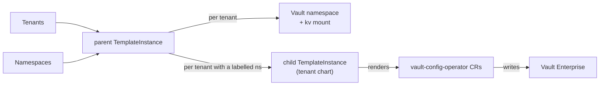

# Vault Enterprise

Give every tenant its own **Vault Enterprise namespace** — with a KV secrets engine, Kubernetes login, per-application policies and (optionally) human SSO and delivery as Kubernetes `Secret`s — derived from the `Tenant` you already maintain and kept in sync as it changes.

!!! note
    This is the Helm-chart Vault Enterprise extension ([`mto-extension-vault-enterprise`](https://github.com/stakater/mto-extension-vault-enterprise)). It is separate from the built-in [Vault integration](../vault/vault.md); use this one for per-tenant Vault **Enterprise namespaces**.

!!! warning "Requires Template Operator v2, VCO and Vault Enterprise"
    The extension is **configuration** — it installs no controller of its own. It renders [Template Operator v2](https://github.com/stakater/template-operator-v2) objects (`templates.v2.stakater.com`), which in turn render [`vault-config-operator`](https://github.com/redhat-cop/vault-config-operator) (VCO) custom resources; VCO writes them to Vault. Both operators must be running, and Vault must be **Enterprise** (tenant isolation is one Vault *namespace* per tenant, and namespaces exist only in Enterprise). See [Installation](installation.md).

## At a glance

| You maintain | The extension keeps in sync |
|:---|:---|
| a `Tenant` | a Vault namespace per tenant, with its own `kv/` mount |
| namespaces labelled for it | a Kubernetes auth mount workloads log in with |
| a ServiceAccount annotation per app | a policy + login role per app, scoped to its own KV path |
| (optional) a Deployment annotation | the secret delivered as a Kubernetes `Secret` via External Secrets |

**You write** — annotate a workload's ServiceAccount:

```yaml
apiVersion: v1
kind: ServiceAccount
metadata:
  name: checkout
  namespace: acme-shop            # a namespace labelled stakater.com/tenant: acme
  annotations:
    vault.stakater.com/kv: "true"      # give this app its own KV prefix
    vault.stakater.com/role: editor    # read + write there
```

**You get** — inside the tenant's Vault namespace, created for you:

- a KV path the app can reach, `kv/data/<env>/acme-shop/checkout/…`,
- a Vault `Policy` and a Kubernetes login role `kv.acme.acme-shop.checkout`,
- a `ConfigMap` `vault-config-checkout` in `acme-shop` with the `VAULT_*` values the app needs to log in and find its path.

The pod logs in with the ServiceAccount token Kubernetes already gives it — no static Vault credential.

## How it works



A **bootstrap chart** (installed once) runs the parent, which renders each tenant's Vault namespace and KV mount itself and emits one child `TemplateInstance` per tenant that has a labelled namespace. Each child pulls the **tenant chart** and renders that tenant's VCO resources. The tenant's Vault namespace and KV mount are rendered by the parent, so they live as long as the `Tenant` — not as long as its namespaces.

## Who does what

| | Platform / Vault administrator | Tenant |
|:---|:---|:---|
| **Sets up once** | the Vault login for VCO; installs the bootstrap chart | — |
| **Per tenant** | nothing | annotates ServiceAccounts/Deployments for the access each app needs |
| **Never** | writes per-tenant Vault policies by hand | holds a static Vault credential, or reaches another tenant's namespace |

## How roles map to Vault access

A workload's `vault.stakater.com/role` sets what it may do on its KV paths:

| Role | KV capabilities |
|:---|:---|
| `audit-read` | list names only — no values |
| `viewer` | read, list |
| `editor` | create, read, update, patch, list |
| `admin` | editor, plus delete and destroy versions |

Human SSO users get the same roles, from their identity-provider group — see [Delivery and login](delivery-and-login.md#human-sso).

!!! info "Built on Template Operator v2"
    Because the extension renders through Template Operator v2, the permissions the bootstrap grants are shared with anyone who can author a `Template`. On a cluster where tenants (or others) can create Templates, read [Security → Template authors share these permissions](security.md#template-authors-share-these-permissions) before production.

## In this section

1. [Installation](installation.md) — prerequisites, the one-time Vault bootstrap, install the bootstrap chart
1. [Giving an application a secret](giving-an-application-a-secret.md) — annotate a ServiceAccount, write and read a secret
1. [Secrets and sharing](secrets-and-sharing.md) — the KV layout, sharing within and between tenants
1. [Delivery and login](delivery-and-login.md) — Kubernetes `Secret`s via External Secrets, and human SSO
1. [Security](security.md) — the trust boundary and the Template-author caveat
1. [Operating](operating.md) — health, troubleshooting, deletion, monitoring, uninstall
1. [Reference](reference.md) — bootstrap values and the annotation reference

---

**Next:** [Installation](installation.md)
