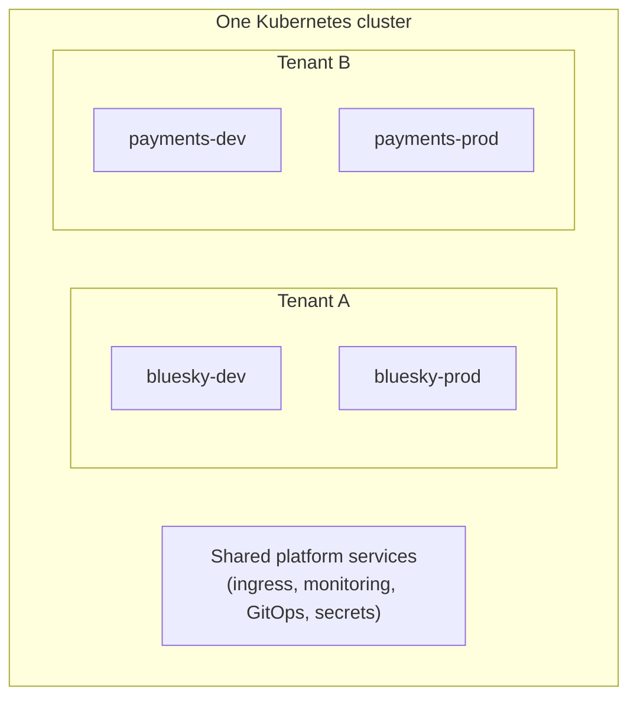
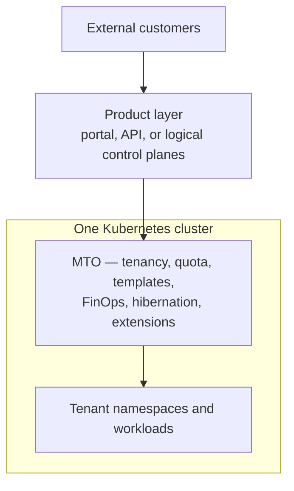
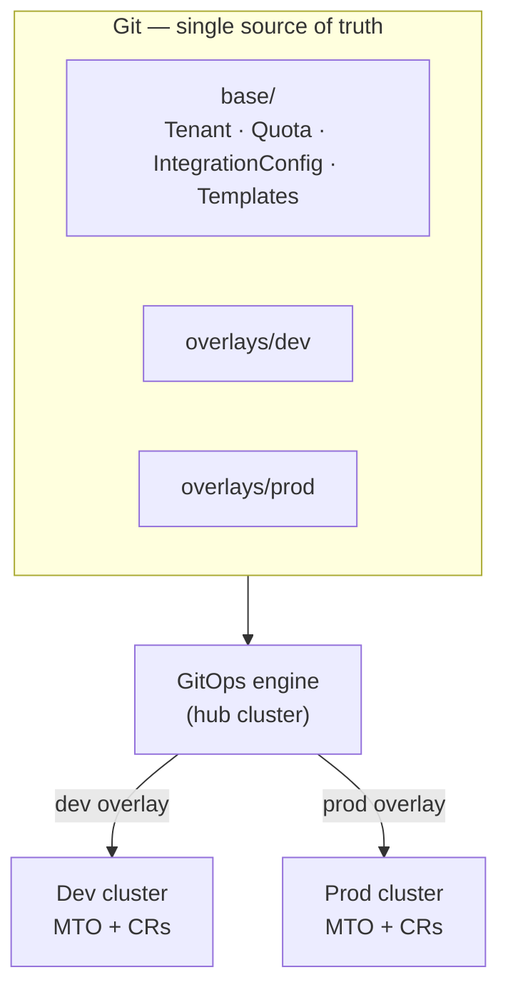
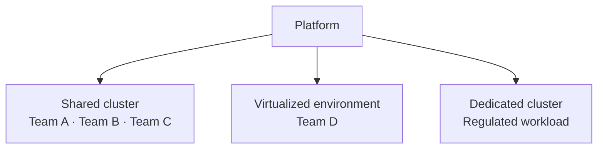

# Deployment Models

There is no single Kubernetes multi-tenancy architecture that suits every workload. Some organizations share one cluster between teams; some need stronger isolation through virtual clusters; some need a dedicated cluster per tenant. Large platforms usually end up with more than one.

These are decisions about **isolation**. MTO is a decision about the **operating model** — who a tenant is, what they own, what they may consume, and what boundaries apply. The two are separate choices, and conflating them is what makes the "namespaces or clusters?" debate go in circles.

This page describes where MTO fits in each architecture.

## Shared clusters

Multiple tenants run on the same cluster, separated by namespace, RBAC, quota, network policy and admission control.

**This is the model MTO is built for.** Everything MTO does — tenant ownership, namespace lifecycle, RBAC, quota at the tenant scope, admission guardrails, network isolation, templates, cost attribution, hibernation, and extension into ArgoCD and OpenBao/Vault — applies directly here.

It suits internal development teams, shared enterprise platforms, development and test environments, and any situation where efficient infrastructure sharing matters.

The limit is worth stating precisely, because it is narrower than it first appears: tenants who hold cluster credentials share one API server and one set of nodes. Where tenants do not hold cluster credentials at all, that limit does not apply — see the next section.

## When tenants never touch the cluster API

The isolation question is usually posed as *how much do you trust your tenants?* That is the wrong first question. The right one is:

> Do tenants talk to the cluster API themselves, or does a product sit in front?

For internal platforms the answer is usually the former: developers run `kubectl`, so the cluster's boundary is the boundary the tenant experiences, and the tenant's trustworthiness matters directly.

For service providers, SaaS vendors and telecommunications platforms it is usually the latter. Customers are served through a portal, an API or a logical control plane. They never receive cluster credentials and cannot reach the Kubernetes API at all — so the fact that the cluster is shared is an implementation detail behind the product, not a boundary the customer is on the other side of.

In this shape, MTO does the groundwork underneath the product:

- **Tenancy** — one customer, one tenant; namespaces, access and isolation reconciled from a single definition the product layer creates
- **Quota** — what each customer may consume, mapped to whatever plan they bought
- **Templates** — every customer environment provisioned identically, by construction rather than by checklist
- **FinOps** — cost-to-serve per customer as a figure you read rather than model
- **Hibernation** — dormant customer environments stop costing money
- **Extensions** — the customer's boundary carried into GitOps and secrets management
- **Console** — an interface over the same objects for your own operators, whatever the product layer shows the customer

The externally facing control plane is a separate layer, and one way to build it is with logical control planes — see [MTO vs KCP](../learn/mto-vs-kcp.md), which describes that composition rather than treating the two as alternatives.

This is a common and deliberate architecture, and it is why "our customers are external" does not, on its own, rule out a shared cluster. What rules it out is tenants holding cluster credentials whose use you cannot bound, or a regulatory requirement that names infrastructure separation specifically.

## Virtual clusters

Virtual-cluster technologies give each tenant a separate Kubernetes control-plane experience — its own API server and its own CRDs — while sharing the underlying compute.

That solves a different problem from the one MTO solves. A virtual cluster is a stronger *isolation* boundary; it does not tell you who owns it, what it may consume, what it costs, or how it is standardized. Those questions come back the moment you have thirty virtual clusters instead of thirty namespaces.

Use a virtual cluster when a tenant needs:

- CRDs or cluster-scoped configuration that would conflict with another tenant's
- Cluster-admin-like autonomy inside its own boundary
- Control-plane separation that namespace isolation cannot provide

Virtual clusters and MTO are not competing answers to one question. They answer different questions, at different layers.

## Dedicated clusters

Some tenants require complete cluster isolation — for regulatory or security reasons, for customer-contractual isolation, or because the workload's scale or lifecycle demands it.

Dedicated clusters give the strongest boundary and the highest operational cost: every cluster is another control plane, monitoring stack, upgrade cycle and on-call surface.

MTO is installed per cluster, and each installation governs only its own cluster. Running several clusters consistently is a GitOps pattern rather than an MTO feature — see [Running MTO across many clusters](#running-mto-across-many-clusters).

This is a working pattern rather than a theoretical one: one public sector customer runs MTO across several clusters, the largest of them carrying more than 100 tenants and 700 namespaces.

## Running MTO across many clusters

Most platforms run more than one cluster — a cluster per environment (dev, staging, prod), per region, or a dedicated cluster alongside a shared one. MTO has no fleet controller and no cross-cluster view: each installation governs only the cluster it runs in. Consistency across clusters does not come from MTO federating them — it comes from **where the tenant definitions live**.

**Local runtime, central definition.** The operator, and the `Tenant`, `Quota` and `IntegrationConfig` resources, are local to each cluster — they run in, and are stored by, that cluster's own API server. But the *definitions* of those resources are authored once, in Git, and delivered to every cluster by a GitOps engine (Argo CD, Flux) or a cluster-management layer such as RHACM. One source of truth, reviewed in one place; every cluster kept in step with it.

The platform standards rolled into tenant namespaces — baseline RBAC, network policies, image-pull secrets — are part of that same central definition. They are expressed as [Template Operator v2](../getting-started/installation/operators/template-operator-v2.md) `Template` and `TemplateInstance` objects, which ship with MTO, and they travel in the base alongside the `Tenant`: distributed to every cluster and reconciled locally, so the same standards reach every tenant namespace on every cluster. Standards should not differ between clusters, so they stay in the base and no overlay touches them — only consumption and environment-specific guardrails belong in overlays.

**Same tenant, per-cluster overlay.** When one team spans several clusters, keep the tenant's *identity* the same everywhere — `acme` on the dev cluster and `acme` on the prod cluster are the same team — and express what differs per environment as an overlay on a shared base: a larger `Quota` and stricter network policy in prod, a smaller footprint in dev. Forking a separate definition per cluster is exactly what lets dev and prod drift apart, which is the problem a single definition exists to prevent.

This is a GitOps composition around N independent installs, not a feature of MTO: the hub distributes the base plus each cluster's overlay, and MTO on each spoke reconciles what it receives.

## Hybrid platforms

Most large platforms arrive here:

The useful question is not *"namespaces or dedicated clusters?"* It is:

> What level of isolation does each workload actually require, and how do we give every tenant a consistent platform experience across those boundaries?

## Choosing the model

| Requirement | Shared cluster | Virtual cluster | Dedicated cluster |
|---|---|---|---|
| Infrastructure efficiency | High | High | Lower |
| Namespace isolation | Yes | Yes | Yes |
| Kubernetes API isolation | Limited | Stronger | Strongest |
| Control-plane autonomy | Low | Higher | Full |
| Infrastructure isolation | Low | Partial | Full |
| Operational overhead | Low | Medium | High |
| Typical cost | Lower | Medium | Higher |

MTO is strongest where the goal is to turn Kubernetes infrastructure into an operational multi-tenant *platform*, rather than only to draw an isolation boundary. Pick the isolation architecture from the workload's requirements; pick the tenant operating model separately.

## Next

- [Why MTO](why-mto.md) — the argument for the operating model
- [How MTO Works](how-it-works.md) — the reconciliation path, end to end
- [Use Cases](use-cases.md) — the situations these models show up in
